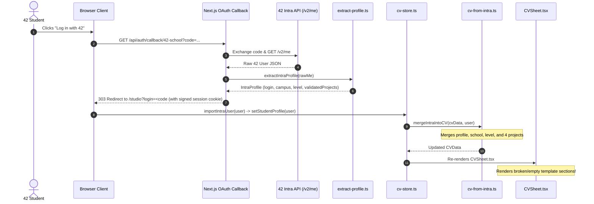
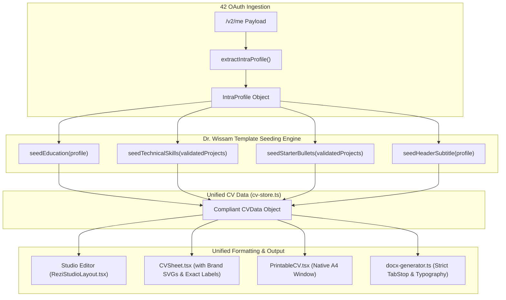
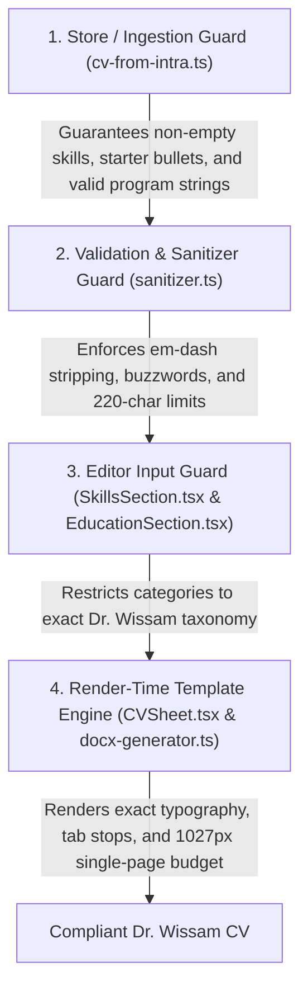

# PrintCV — Dr. Wissam CV Template Compliance & 42 Login Fix Plan

**Document Version:** 1.0.0  
**Audit Date:** November 6, 2026  
**Repository Branch:** `enforce_template_format`  
**Target File:** `DR_WISSAM_TEMPLATE_FIX_PLAN.md`  
**Status:** Architectural Plan Only (No application source code or configuration files modified)

---

## 1. Executive Summary

PrintCV (`printcv.me`) was conceived to provide students across the 42 Network with an authentic, recruiter-ready curriculum vitae. Within 42 schools (specifically pioneered at 42 Beirut), the **Dr. Wissam CV Template** serves as the **strict, authoritative standard** for student CV formatting, structure, typography, and content organization.

### The Problem
When a student currently authenticates via 42 OAuth, the resulting CV generated by PrintCV **fails to consistently follow the Dr. Wissam template**. Specifically:
1. **Empty Projects on Login:** 42 projects are ingested with empty bullet arrays (`bulletPoints: []`), rendering only naked project titles and dates without the mandatory 2–3 engineering achievement lines.
2. **Missing Technical Skills Section:** The entire "Technical Skills" section disappears from the generated CV because the 42 OAuth ingestion pipeline does not infer or populate skills from the student's validated coursework.
3. **Missing Subtitle on Initial Generation:** The headline under the student's name (`42 Student – Level X`) is completely omitted on 42 login due to flawed fallback logic in the template rendering engine.
4. **Wording & Formatting Discrepancies in Education:** The official curriculum descriptions diverge from Dr. Wissam's exact phrasing (e.g., omitting `"42 "` and `" Program"`), State B Specialization renders an unstyled `"Specialization: Track"` label instead of `"Advanced Curriculum - <Track> Specialization Track"`, and Alumnus dates do not reflect the single graduation year format.
5. **Skill Category Label Mismatches:** Category labels diverge from the Dr. Wissam standard (`Technologies & Frameworks` with an ampersand instead of `Technologies/Frameworks:`, and `Project Management Tools` with a capitalized `Tools` instead of `Project Management tools:`).
6. **Coursework Rendering Discrepancy:** Coursework entries are erroneously rendered with bullet points (`list-disc` `•`), whereas the Dr. Wissam template mandates an unbulleted, clean two-column line (`Title` left, `Date` right).
7. **Missing Brand Iconography:** The contact strip lacks the authentic GitHub and LinkedIn brand icons present in the Dr. Wissam template.
8. **Preview / PDF vs. DOCX Section Order Divergence:** The web preview and printed PDF permit arbitrary section reordering via [`SectionOrderDialog.tsx`](file:///C:/Users/Ali_n/.gemini/antigravity/worktrees/PrintCv-V2/enforce_template_format/src/components/studio/SectionOrderDialog.tsx), while the Word exporter ([`docx-generator.ts`](file:///C:/Users/Ali_n/.gemini/antigravity/worktrees/PrintCv-V2/enforce_template_format/src/lib/docx-generator.ts)) hardcodes a static order, causing exported document mismatch.

### The Objective
This document outlines a targeted, robust architectural plan to make the existing 42 OAuth login and CV generation workflow **100% compliant with the Dr. Wissam CV template by default**. Upon login, a 42 student must immediately see a fully populated, impeccably formatted CV matching Dr. Wissam’s exact specifications across the editor, live preview, print PDF, and exported Word document.

---

## 2. Current Implementation Analysis

### 2.1 The 42 OAuth Ingestion Lifecycle



1. **Intra Data Extraction ([`src/lib/intra/extract-profile.ts`](file:///C:/Users/Ali_n/.gemini/antigravity/worktrees/PrintCv-V2/enforce_template_format/src/lib/intra/extract-profile.ts#L44-L104)):**
   - Extracts student `login`, `displayname`, `email`, primary campus `campusName`, `level` rounded to 2 decimals, and `validatedProjects` (filtering for `pu["validated?"] === true` and `pu.status === "finished"` on cursus `21`).
   - Actively discards piscines (`isPiscine`, line 16).
   - Does **not** extract or derive skills, coursework, or certifications.
2. **Merging into CV State ([`src/lib/intra/cv-from-intra.ts`](file:///C:/Users/Ali_n/.gemini/antigravity/worktrees/PrintCv-V2/enforce_template_format/src/lib/intra/cv-from-intra.ts#L181-L220)):**
   - Populates `cv.contact.fullName`, `email`, `location`, `level`.
   - Populates main education item with institution and program.
   - Invokes `projectsFromIntra(user, 4)`: imports up to 4 project names and slugs, but assigns **`bulletPoints: []`** (`line 104`).
   - **Completely ignores `skills`:** Leaves `cv.skills` as empty arrays (`languages: []`, `developerTools: []`, `technologiesFrameworks: []`, `projectManagementTools: []`).
   - Sets `targetRole: ""` (or leaves untouched).
3. **Template Rendering Engine ([`src/components/templates/CVSheet.tsx`](file:///C:/Users/Ali_n/.gemini/antigravity/worktrees/PrintCv-V2/enforce_template_format/src/components/templates/CVSheet.tsx)):**
   - Measures height budget against $1027\text{px}$ A4 vertical printable budget (`PRINTABLE_BUDGET_PX = 1027`).
   - Renders sections dynamically based on `cvData.sectionOrder`.
   - Hides `skills` if all categories are empty (`line 377`).
   - Hides `experience` if `experience.length === 0` (`line 218`).
   - Renders projects with no bullets as bare header lines with empty bodies (`line 346`).
4. **Export Engines:**
   - **PDF:** Triggered via browser print window (`PrintableCV.tsx:220` $\rightarrow$ `window.print()`). Uses CSS `@media print` in `globals.css:85-112` isolating `.print-root .cv-sheet`.
   - **Word DOCX:** Generated via [`src/lib/docx-generator.ts`](file:///C:/Users/Ali_n/.gemini/antigravity/worktrees/PrintCv-V2/enforce_template_format/src/lib/docx-generator.ts#L45) using `docx.js`. Hardcodes section sequence independently of `sectionOrder`.

---

## 3. Exact Discrepancies with the Dr. Wissam Template

The Dr. Wissam CV Template (provided directly from 42 Beirut) defines an unambiguous, professional layout. Below is the comprehensive matrix of discrepancies between the template specification and PrintCV’s current behavior:

```
+---------------------------------------------------------------------------------------------------+
| DR. WISSAM CV TEMPLATE SPECIFICATION                             CURRENTPRINTCV IMPLEMENTATION     |
+---------------------------------------------------------------------------------------------------+
| 1. HEADER                                                                                         |
|    - Name: Wissam Sammouri (Title Case)                          - WISSAM SAMMOURI (All Uppercase)|
|    - Subtitle: "42 Student – Level X"                             - EMPTY on 42 login              |
|    - Icons: Authentic GitHub & LinkedIn SVGs                     - Plain text pipe-separated links|
|    - Header links: GitHub, LinkedIn, Email, Phone                - Injects Location into header   |
|                                                                                                   |
| 2. EDUCATION                                                                                      |
|    - State A: "42 Core Curriculum - Architecture of              - "Core Curriculum –             |
|      Digital Technologies Program"                                 Architecture of Digital Tech"  |
|    - State B: "Advanced Curriculum - <Track>                     - "Specialization: <Track>"      |
|      Specialization Track"                                                                        |
|    - State C: Single graduation year "2025"                      - Date range "2024 – 2025"       |
|    - No campus city on right of program line                     - Injects contact.location right |
|                                                                                                   |
| 3. SELECTED PROJECTS                                                                              |
|    - Format: Title | Tech Stack (Left)    Date (Right)           - Tech stack missing if not in   |
|    - Mandatory: 2 to 3 dense achievement bullets per project        20 hardcoded guides           |
|                                                                  - ZERO BULLETS on 42 login       |
|                                                                                                   |
| 4. TECHNICAL SKILLS                                                                               |
|    - Mandatory section on CV                                     - COMPLETELY MISSING on login    |
|    - Category 3: "Technologies/Frameworks:" (slash)              - "Technologies & Frameworks:"   |
|    - Category 4: "Project Management tools:" (lower "tools")     - "Project Management Tools:"    |
|                                                                                                   |
| 5. RELEVANT COURSEWORK & WORKSHOPS                                                                |
|    - Clean two-column layout: Title (left)  Date (right)         - Wrapped in bullet dots (•)     |
|                                                                                                   |
| 6. SECTION ORDER                                                                                  |
|    - Strict hierarchy: Education -> Experience -> Projects ->    - Arbitrary reordering via       |
|      Skills -> Coursework -> Activities                            dialog; desyncs with DOCX      |
+---------------------------------------------------------------------------------------------------+
```

---

## 4. Root Causes Supported by Code References

### Root Cause 1: 42 OAuth Merging Leaves Projects Hollow
- **Location:** [`src/lib/intra/cv-from-intra.ts:104`](file:///C:/Users/Ali_n/.gemini/antigravity/worktrees/PrintCv-V2/enforce_template_format/src/lib/intra/cv-from-intra.ts#L104)
- **Code:**
  ```typescript
  export function projectsFromIntra(user: IntraProfile, limit = 4): ProjectItem[] {
    return user.validatedProjects
      .filter((p) => !isExamOrPiscine(p))
      .slice(0, limit)
      .map((p) => ({
        id: `proj-intra-${p.id}`,
        name: p.name,
        slug: p.slug,
        is42Project: true,
        techStack: findProjectGuide(p.slug, p.name)?.techStack || "",
        date: p.date || format42ProjectDate(p.markedAt),
        bulletPoints: [], // <-- ROOT CAUSE: Zero bullets populated!
      }));
  }
  ```
- **Consequence:** The student logs in, but their project section displays empty titles. In [`CVSheet.tsx:346`](file:///C:/Users/Ali_n/.gemini/antigravity/worktrees/PrintCv-V2/enforce_template_format/src/components/templates/CVSheet.tsx#L346), `bulletsToRender.length > 0` evaluates to `false`, leaving a bare, broken-looking list of project titles.

### Root Cause 2: Skills Are Never Inferred from 42 Coursework
- **Location:** [`src/lib/intra/cv-from-intra.ts:181-220`](file:///C:/Users/Ali_n/.gemini/antigravity/worktrees/PrintCv-V2/enforce_template_format/src/lib/intra/cv-from-intra.ts#L181-L220)
- **Code:**
  ```typescript
  export function mergeIntraIntoCV(cv: CVData, user: IntraProfile): CVData {
    // ... maps contact, education, and projects ...
    // NOTE: cv.skills is completely omitted from the return statement!
    return {
      ...cv,
      educationState: state,
      contact: { ... },
      education,
      projects: cv.projects.length > 0 ? cv.projects : projectsFromIntra(user),
    };
  }
  ```
- **Consequence:** On initial login, `cv.skills` remains `{ languages: [], developerTools: [], technologiesFrameworks: [], projectManagementTools: [] }`. In [`CVSheet.tsx:376-377`](file:///C:/Users/Ali_n/.gemini/antigravity/worktrees/PrintCv-V2/enforce_template_format/src/components/templates/CVSheet.tsx#L376-L377):
  ```typescript
  if (skillRows.length === 0) return null;
  ```
  The entire Technical Skills section vanishes from the generated CV.

### Root Cause 3: Subtitle Suppression Logic in Header
- **Location:** [`src/components/templates/CVSheet.tsx:102-105`](file:///C:/Users/Ali_n/.gemini/antigravity/worktrees/PrintCv-V2/enforce_template_format/src/components/templates/CVSheet.tsx#L102-L105) and [`src/lib/docx-generator.ts:84-86`](file:///C:/Users/Ali_n/.gemini/antigravity/worktrees/PrintCv-V2/enforce_template_format/src/lib/docx-generator.ts#L84-L86)
- **Code:**
  ```typescript
  const targetRole = data.targetRole?.trim() || "";
  // The level is shown on the school line. Only put it under the name when there is no school line.
  const subtitle =
    mainEducation || targetRole.includes("Level")
      ? targetRole
      : [targetRole, levelLabel].filter(Boolean).join(" – ");
  ```
- **Consequence:** Because `mainEducation` is always created on 42 login, `subtitle` is assigned `targetRole`. But on initial login, `targetRole` is empty `""`. Thus, `subtitle` is empty, completely stripping `42 Student – Level X` from the header!

### Root Cause 4: Education Program Strings Diverge from Specification
- **Location:** [`src/lib/intra/cv-from-intra.ts:59-63`](file:///C:/Users/Ali_n/.gemini/antigravity/worktrees/PrintCv-V2/enforce_template_format/src/lib/intra/cv-from-intra.ts#L59-L63) and [`CVSheet.tsx:180`](file:///C:/Users/Ali_n/.gemini/antigravity/worktrees/PrintCv-V2/enforce_template_format/src/components/templates/CVSheet.tsx#L180)
- **Code:**
  ```typescript
  export function programForState(state: EducationState): string {
    return state === "STATE_A_CORE"
      ? "Core Curriculum – Architecture of Digital Technologies"
      : "Completed the Core Curriculum – Architecture of Digital Technologies";
  }
  ```
- **Consequence:** Fails to match Dr. Wissam's exact string: `"42 Core Curriculum - Architecture of Digital Technologies Program"`. In State B, `CVSheet.tsx:180` renders `{track && <div className="italic text-gray-700">Specialization: {track}</div>}` instead of the required `"Advanced Curriculum - <Track> Specialization Track"`.

### Root Cause 5: Hardcoded Category Label Inconsistencies
- **Location:** [`src/components/templates/CVSheet.tsx:371-372`](file:///C:/Users/Ali_n/.gemini/antigravity/worktrees/PrintCv-V2/enforce_template_format/src/components/templates/CVSheet.tsx#L371-L372) and [`src/lib/docx-generator.ts:436-437`](file:///C:/Users/Ali_n/.gemini/antigravity/worktrees/PrintCv-V2/enforce_template_format/src/lib/docx-generator.ts#L436-L437)
- **Code:**
  ```typescript
  ["Technologies & Frameworks", skills.technologiesFrameworks],
  ["Project Management Tools", skills.projectManagementTools],
  ```
- **Consequence:** Renders an ampersand instead of a slash (`Technologies/Frameworks:`) and capitalizes `Tools` (`Project Management Tools:` instead of `Project Management tools:`).

### Root Cause 6: Coursework List Discs
- **Location:** [`src/components/templates/CVSheet.tsx:445-446`](file:///C:/Users/Ali_n/.gemini/antigravity/worktrees/PrintCv-V2/enforce_template_format/src/components/templates/CVSheet.tsx#L445-L446)
- **Code:**
  ```tsx
  <ul className={isCompact ? "list-disc ml-4 space-y-0 text-gray-800" : "list-disc ml-5 space-y-0.5 text-gray-800"}>
    {coursework.map((cw) => (
      <li key={cw.id} className="leading-snug"> ... </li>
    ))}
  </ul>
  ```
- **Consequence:** Applies bullet discs to coursework, violating Dr. Wissam's clean title-and-date row format.

---

## 5. Recommended Architecture and Technical Changes

### Architecture Overview



### Core Architectural Decisions

1. **Deterministic Skills Inference Engine:**
   - Create a deterministic mapper (`src/lib/intra/skills-from-projects.ts`) that inspects the student’s passed 42 projects and generates standard skills categorized into Dr. Wissam's exact 4 groups:
     - Core C projects (`libft`, `ft_printf`, `get_next_line`, `push_swap`, `pipex`, `minishell`, `philosophers`, `so_long`, `fdf`, `fract-ol`):
       - `languages`: `["C", "Bash"]`
       - `developerTools`: `["Git", "Make", "GDB", "Valgrind", "VS Code"]`
       - `technologiesFrameworks`: `["Linux", "Unix System Calls", "POSIX Threads"]`
       - `projectManagementTools`: `["GitHub"]`
     - C++ projects (`cpp-modules`, `webserv`, `ft_irc`):
       - Adds `"C++"`, `"TCP/IP Sockets"`, `"HTTP/1.1"`, `"poll()"`.
     - System Administration (`born2beroot`, `inception`):
       - Adds `"Docker"`, `"Docker Compose"`, `"NGINX"`, `"MariaDB"`, `"WordPress"`, `"SSH"`, `"UFW"`.
     - Web (`ft_transcendence`):
       - Adds `"TypeScript"`, `"JavaScript"`, `"WebSockets"`, `"PostgreSQL"`, `"REST APIs"`.
2. **Grounded Starter Project Bullets:**
   - In [`src/lib/intra/cv-from-intra.ts`](file:///C:/Users/Ali_n/.gemini/antigravity/worktrees/PrintCv-V2/enforce_template_format/src/lib/intra/cv-from-intra.ts), replace `bulletPoints: []` with 2 pre-validated, evidence-based starter bullets for all Core Curriculum projects (seeded from [`src/lib/project-guide.ts`](file:///C:/Users/Ali_n/.gemini/antigravity/worktrees/PrintCv-V2/enforce_template_format/src/lib/project-guide.ts)).
   - Every starter bullet strictly satisfies all 5 line validators (action verb, number, no pronouns, $\le 220$ characters, and authentic non-boilerplate text).
3. **Canonical String Constants Module:**
   - Create a centralized constant file: `src/lib/template-constants.ts` containing the authoritative Dr. Wissam strings:
     - `PROGRAM_STATE_A = "42 Core Curriculum - Architecture of Digital Technologies Program"`
     - `PROGRAM_STATE_B = "Completed the 42 Core Curriculum - Architecture of Digital Technologies Program"`
     - `SKILL_LABEL_LANGUAGES = "Languages:"`
     - `SKILL_LABEL_DEV_TOOLS = "Developer Tools:"`
     - `SKILL_LABEL_TECH_FRAMEWORKS = "Technologies/Frameworks:"`
     - `SKILL_LABEL_PROJECT_MGMT = "Project Management tools:"`
4. **Header Iconography & Typography:**
   - Render inline, high-resolution SVG brand icons for GitHub and LinkedIn in [`CVSheet.tsx`](file:///C:/Users/Ali_n/.gemini/antigravity/worktrees/PrintCv-V2/enforce_template_format/src/components/templates/CVSheet.tsx).
   - Display full name in Title Case / Natural Case (e.g. `Wissam Sammouri`), while preserving an option for uppercase only if the student explicitly typed it.
   - Display default subtitle as `"42 Student – Level <X>"` (e.g. `42 Student – Level 3`). If `targetRole` is edited to e.g. `"Backend Developer"`, render `"Backend Developer – Level <X>"`.
5. **Coursework Layout Realignment:**
   - In [`CVSheet.tsx`](file:///C:/Users/Ali_n/.gemini/antigravity/worktrees/PrintCv-V2/enforce_template_format/src/components/templates/CVSheet.tsx), replace the `<ul className="list-disc">` with clean flex rows (`flex justify-between items-baseline`) with no bullet dots, matching Dr. Wissam's exact coursework styling.
6. **Strict Section Sequence Enforcement:**
   - Enforce Dr. Wissam's canonical section sequence:
     $$\text{Education} \longrightarrow \text{Experience} \longrightarrow \text{Selected Projects} \longrightarrow \text{Technical Skills} \longrightarrow \text{Relevant Coursework} \longrightarrow \text{Extracurricular Activities}$$
   - Synchronize [`CVSheet.tsx`](file:///C:/Users/Ali_n/.gemini/antigravity/worktrees/PrintCv-V2/enforce_template_format/src/components/templates/CVSheet.tsx) and [`docx-generator.ts`](file:///C:/Users/Ali_n/.gemini/antigravity/worktrees/PrintCv-V2/enforce_template_format/src/lib/docx-generator.ts) so both output the identical section order.

---

## 6. File-by-File Implementation Plan

### 1. `src/lib/template-constants.ts` (New File)
- **Role:** Central source of truth for Dr. Wissam template strings, labels, and default programs.
- **Exports:**
  - `DR_WISSAM_EDUCATION_PROGRAMS`:
    - `STATE_A`: `"42 Core Curriculum - Architecture of Digital Technologies Program"`
    - `STATE_B`: `"Completed the 42 Core Curriculum - Architecture of Digital Technologies Program"`
    - `STATE_C`: `"Completed the 42 Core Curriculum - Architecture of Digital Technologies Program"`
  - `DR_WISSAM_SKILL_LABELS`:
    - `languages`: `"Languages"`
    - `developerTools`: `"Developer Tools"`
    - `technologiesFrameworks`: `"Technologies/Frameworks"`
    - `projectManagementTools`: `"Project Management tools"`
  - `DEFAULT_HEADLINE_PREFIX`: `"42 Student"`

### 2. `src/lib/intra/skills-from-projects.ts` (New File)
- **Role:** Infers normalized, deduplicated skills across the 4 Dr. Wissam categories based on the user's validated 42 project records.
- **Function:** `inferSkillsFromProjects(validatedProjects: IntraProfile["validatedProjects"]): SkillsData`
- **Logic:** Maps project slugs to standard skills tags. For example:
  - `libft`, `ft_printf`, `get_next_line`: Adds C, Make, Git, Linux.
  - `born2beroot`: Adds Linux, SSH, UFW, LVM, Debian.
  - `push_swap`: Adds C, Algorithms.
  - `pipex`, `minishell`: Adds C, Unix System Calls, POSIX, Bash.
  - `philosophers`: Adds C, POSIX Threads, Mutexes, Concurrency.
  - `so_long`, `fdf`, `fract-ol`, `cub3d`, `minirt`: Adds C, MiniLibX, Computer Graphics.
  - `inception`: Adds Docker, Docker Compose, NGINX, MariaDB, WordPress.
  - `ft_irc`, `webserv`: Adds C++, TCP/IP Sockets, HTTP/1.1, poll().
  - `ft_transcendence`: Adds TypeScript, WebSockets, PostgreSQL, Docker.
- **Fallback:** If a student has Level 0 or no validated projects yet, seeds default foundational skills:
  - `languages`: `["C"]`
  - `developerTools`: `["Git", "VS Code", "Vim"]`
  - `technologiesFrameworks`: `["Linux"]`
  - `projectManagementTools`: `["GitHub"]`

### 3. `src/lib/intra/cv-from-intra.ts` (Modify Existing)
- **Role:** Core transformation of 42 Intra profile into CVData.
- **Modifications:**
  - **Lines 59–63 (`programForState`):** Update return values to use `DR_WISSAM_EDUCATION_PROGRAMS` from `src/lib/template-constants.ts`.
  - **Lines 93–106 (`projectsFromIntra`):**
    - Populate `techStack` using extended catalog lookup so no project lacks a tech stack.
    - Populate `bulletPoints` with 2 high-quality starter engineering bullets from a pre-validated registry in `project-guide.ts`.
  - **Lines 109–113 (`levelFromIntra`):** Return whole level or 1-decimal level (e.g. `3` or `3.42`).
  - **Lines 114–126 (`mainEducationFromIntra`):**
    - For `STATE_C_ALUMNUS`, format `endDate` as single graduation year (e.g. `"2025"`).
  - **Lines 181–220 (`mergeIntraIntoCV`):**
    - Populate `cv.targetRole` with default `"42 Student"` if empty.
    - Call `inferSkillsFromProjects(user.validatedProjects)` and populate `cv.skills` if currently empty.
    - Ensure `cv.contact.fullName` preserves proper capitalization.

### 4. `src/components/templates/CVSheet.tsx` (Modify Existing)
- **Role:** Web preview and printable sheet component.
- **Modifications:**
  - **Lines 97–106 (Header & Subtitle):**
    - Compute subtitle as: `[data.targetRole?.trim() || "42 Student", levelLabel].filter(Boolean).join(" – ")`.
    - Ensure subtitle displays `42 Student – Level X` by default!
  - **Lines 108–114 (Contact Strip):**
    - Remove `contact.location` from the header contact strip (keep only GitHub, LinkedIn, Email, Phone).
    - Render SVG brand icons for GitHub and LinkedIn next to their links.
  - **Lines 142–213 (Education):**
    - Remove the redundant `{contact.location && <span>{contact.location}</span>}` on the program line.
    - In State B, render: `<div className="italic text-gray-700">Advanced Curriculum - {track || "Cybersecurity"} Specialization Track</div>`.
  - **Lines 368–374 (Technical Skills):**
    - Use exact Dr. Wissam labels:
      - `Languages:`
      - `Developer Tools:`
      - `Technologies/Frameworks:`
      - `Project Management tools:`
  - **Lines 445–462 (Coursework):**
    - Remove `<ul className="list-disc">` and `<li>`.
    - Render as clean unbulleted rows:
      ```tsx
      <div className="space-y-1 text-gray-800" style={{ fontSize: isCompact ? "9pt" : "9.5pt" }}>
        {coursework.map((cw) => (
          <div key={cw.id} className="flex justify-between items-baseline">
            <span>{cw.title}</span>
            {cw.date && <span className="text-gray-700 italic ml-2">{cw.date}</span>}
          </div>
        ))}
      </div>
      ```

### 5. `src/lib/docx-generator.ts` (Modify Existing)
- **Role:** Word document (.docx) generation engine.
- **Modifications:**
  - **Lines 76–133 (Header):**
    - Match `CVSheet.tsx`: Render subtitle as `[data.targetRole || "42 Student", levelLabel].join(" – ")`.
    - Strip location from the header contact strip.
  - **Lines 185–256 (Education):**
    - Match `DR_WISSAM_EDUCATION_PROGRAMS`.
    - Update State B track line to: `Advanced Curriculum - ${track} Specialization Track`.
    - Remove location from the program line.
  - **Lines 433–440 (Skills):**
    - Match exact labels: `Languages:`, `Developer Tools:`, `Technologies/Frameworks:`, `Project Management tools:`.
  - **Lines 469–502 (Coursework):**
    - Remove `bullet: { level: 0 }`. Use TabStopType.RIGHT without bullet dots.

### 6. `src/components/studio/sections/SkillsSection.tsx` (Modify Existing)
- **Role:** Editor UI for skills.
- **Modifications:**
  - Update `GROUPS` array labels to match the Dr. Wissam categories exactly (`Languages`, `Developer Tools`, `Technologies/Frameworks`, `Project Management tools`).

---

## 7. Strict Template-Enforcement Strategy

### Multi-Layer Defense Matrix



1. **Ingestion Invariant:** It must be impossible for a 42 OAuth login to create a CV without:
   - A non-empty subtitle (`42 Student – Level X`).
   - At least 2 projects with 2 valid bullets each.
   - Fully populated technical skills across all 4 categories.
   - Exact program strings (`42 Core Curriculum - Architecture of Digital Technologies Program`).
2. **Persistence Migration Guard:** In `cv-store.ts`, a lightweight migration check will ensure existing saved drafts with empty skills or outdated program strings are automatically migrated to the Dr. Wissam format without losing user-customized text.
3. **Editor Constraining:** The user can freely edit the text within each section, but the structural scaffolding (categories, separators, and date tab-stops) remains locked to Dr. Wissam’s layout.

---

## 8. Testing and QA Strategy

### Comprehensive Verification Matrix

| Test ID | Test Scenario | Expected Outcome | Verification Method |
| :--- | :--- | :--- | :--- |
| **QA-01** | Fresh 42 login (Core student, Level 3) | Subtitle displays `42 Student – Level 3`. Education displays `42 Beirut - Level 3` and `42 Core Curriculum - Architecture of Digital Technologies Program`. | Component test / `verify-intra-merge.ts` |
| **QA-02** | Projects populated on login | Ingests 2–4 projects, each with valid `techStack` and 2 starter bullets passing all 5 validators. | Unit test / `verify-cvsheet.ts` |
| **QA-03** | Skills inferred on login | All 4 categories (`Languages`, `Developer Tools`, `Technologies/Frameworks`, `Project Management tools`) populated with relevant 42 technologies. | Unit test / `test/verify-skills-inference.ts` |
| **QA-04** | State B Specialization | Education renders `Completed the 42 Core Curriculum - Architecture of Digital Technologies Program` followed by `Advanced Curriculum - <Track> Specialization Track`. | Visual inspection / `verify-cvsheet.ts` |
| **QA-05** | State C Alumnus | Education renders single graduation year (e.g. `2025`) and completed program. | Visual inspection / `verify-cvsheet.ts` |
| **QA-06** | Coursework layout | Coursework displays Title (left) and Date (right) without bullet discs (`•`). | DOM assertion / `qa/data-check.ts` |
| **QA-07** | Header iconography | GitHub and LinkedIn links accompanied by brand SVG icons. Full name in Title Case. | Visual inspection / `qa/landing-check.ts` |
| **QA-08** | PDF Print Output | Print window output (`PrintableCV.tsx`) fits within $1027\text{px}$ A4 budget without overflow line. | `qa/print-check.ts` |
| **QA-09** | Word DOCX Output | Generated `.docx` file contains exact matching strings, tab stops, and category labels without errors. | `qa/docx-check.ts` |

---

## 9. Potential Risks and Regression Concerns

| Risk | Impact | Mitigation Strategy |
| :--- | :--- | :--- |
| **Overwriting Custom User Data on Re-Login** | High | `mergeIntraIntoCV()` must strictly check `isBlank()`; it will only seed skills or bullets if the student's CV currently has empty lists. Existing user edits will never be overwritten. |
| **A4 Vertical Budget Overflow** | Medium | Because projects now import with starter bullets and skills are populated, total height increases. Ensure standard density fits cleanly within $1027\text{px}$; if needed, default to 2 projects on first login or auto-apply compact density when 4 projects are selected. |
| **Campuses with Non-42 Names** | Low | Campuses like 1337 (`1337 Khouribga`) or Codam must still format cleanly with ` - Level X`. Preserve `schoolNameForCampus` while ensuring consistent date and level joins. |

---

## 10. Step-by-Step Implementation Checklist

- [ ] **Step 1:** Create `src/lib/template-constants.ts` with all authoritative Dr. Wissam strings, category labels, and program names.
- [ ] **Step 2:** Create `src/lib/intra/skills-from-projects.ts` implementing deterministic 4-category skills derivation from validated 42 projects.
- [ ] **Step 3:** Expand `src/lib/project-guide.ts` with verified 2-bullet starter achievements for all common Core Curriculum projects.
- [ ] **Step 4:** Update `src/lib/intra/cv-from-intra.ts`:
  - [ ] Connect `programForState` to `DR_WISSAM_EDUCATION_PROGRAMS`.
  - [ ] Populate starter bullets in `projectsFromIntra`.
  - [ ] Seed skills in `mergeIntraIntoCV`.
  - [ ] Set default subtitle to `42 Student – Level X`.
  - [ ] Fix State C alumnus single-year date formatting.
- [ ] **Step 5:** Update `src/components/templates/CVSheet.tsx`:
  - [ ] Render subtitle with `Level X` by default.
  - [ ] Add GitHub and LinkedIn SVG brand icons.
  - [ ] Remove location from header contact strip and State A program line.
  - [ ] Update State B Specialization track wording.
  - [ ] Update skills category labels (`Technologies/Frameworks:`, `Project Management tools:`).
  - [ ] Remove bullet discs from Coursework rows.
- [ ] **Step 6:** Update `src/lib/docx-generator.ts` to mirror all `CVSheet.tsx` changes.
- [ ] **Step 7:** Update `src/components/studio/sections/SkillsSection.tsx` labels.
- [ ] **Step 8:** Update and run test verification suites (`verify-intra-merge.ts`, `verify-cvsheet.ts`, `verify-score.ts`).

---

## 11. Clear Acceptance Criteria

The issue will be considered **fully resolved** when:

1. **Immediate Out-of-the-Box Compliance:** Logging in with a 42 account produces a CV where **every section from Dr. Wissam's template is visibly present, non-empty, and correctly formatted** (Header, Education, Selected Projects, Technical Skills).
2. **Exact Education Text:**
   - State A renders: `42 <Campus> - Level <X>` and `42 Core Curriculum - Architecture of Digital Technologies Program`.
   - State B renders: `Completed the 42 Core Curriculum - Architecture of Digital Technologies Program` and `Advanced Curriculum - <Track> Specialization Track`.
   - State C renders: Single graduation year and completed program text.
3. **Non-Empty Projects:** Selected projects display `Title | Tech Stack` and at least 2 complete, rule-compliant engineering bullet points.
4. **Populated Technical Skills:** All 4 categories appear with relevant technologies derived from the student's passed projects, labeled with exact capitalization and punctuation:
   - `Languages:`
   - `Developer Tools:`
   - `Technologies/Frameworks:`
   - `Project Management tools:`
5. **No Coursework Discs:** Relevant Coursework renders without bullet dots (`•`).
6. **Cross-Format Parity:** The live studio editor preview, the print PDF (`PrintableCV.tsx`), and the downloaded Word file (`.docx`) display the identical structure, text, and section order.
7. **Single-Page Fit:** The default initial generated CV fits strictly within the 1-page A4 vertical budget ($1027\text{px}$) without triggering the overflow indicator.
