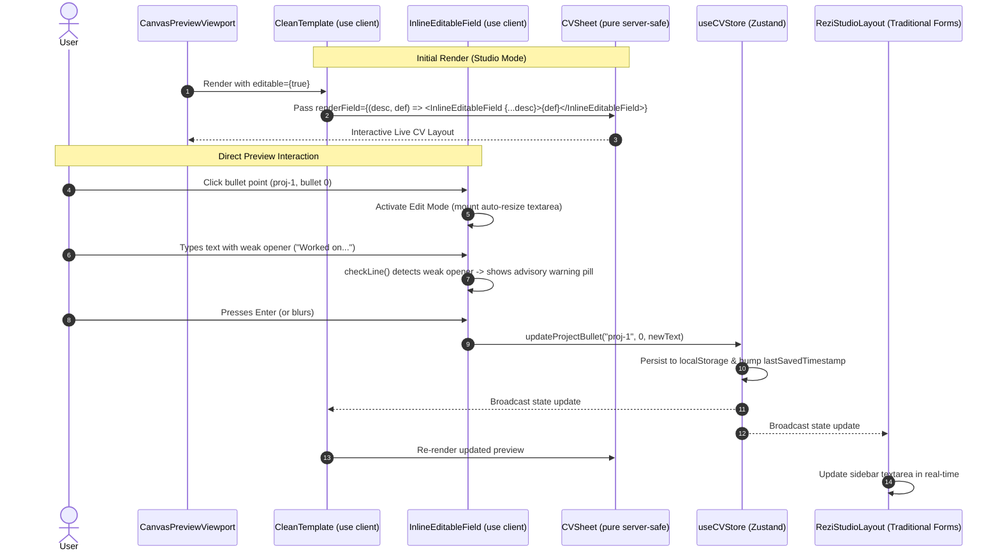

# PrintCV — Level Precision & Live Preview Inline Editing Implementation Plan

**Author:** Senior Software Architect, Senior React/Next.js Engineer, UX Specialist, QA Engineer  
**Date:** November 2026  
**Status:** REVISED ARCHITECTURAL SPECIFICATION — READY FOR REVIEW  
**Branch:** `enforce_template_format`  
**Target Delivery:** `PRINTCV_LEVEL_AND_INLINE_EDIT_PLAN.md`

---

## Executive Summary

This document specifies the architecture, data flow, component boundaries, and testing strategy for two core PrintCV enhancements:

1. **Preserve Full 42 Student Level Precision:**  
   Eliminate integer truncation in 42 OAuth level ingestion by replacing `Math.floor()` with a centralized, two-decimal precision formatter (`format42Level`). Ensure `11.45` $\rightarrow$ `Level 11.45`, `3.5` $\rightarrow$ `Level 3.5`, `5.01` $\rightarrow$ `Level 5.01`, and `2` $\rightarrow$ `Level 2` across the store, preview, print PDF, and Word DOCX, while guaranteeing full backward compatibility and preventing subtitle duplication.

2. **Direct Inline Editing in the Live CV Preview (Dual-Editor Architecture):**  
   Empower students to click directly on CV text elements inside the live visual canvas (name, headline, contact items, education, project titles/stacks, bullet points, skills, and coursework) to edit them in-place.
   - **Retain the traditional sidebar editor** at 100% capability.
   - **Do NOT duplicate the template rendering tree**: Keep a single, unified `CVSheet.tsx` layout.
   - **Preserve server-side rendering and `test/verify-cvsheet.ts`**: `CVSheet.tsx` remains pure, server-safe, and free of client hooks. Interactive editing is injected via parameterized slot rendering in client preview mode.
   - **Support empty & missing fields**: Provide clean, non-printing helpers to add first bullets, append bullets, delete bullets, populate empty skill categories, and fill missing contact items.
   - **Reuse existing validation (`checkLine`)**: Provide live advisory feedback without blocking saves or silently discarding input.
   - **Phased Rollout**: Execute a single-field Proof of Concept (PoC) on project bullets before full rollout.

---

## 1. Confirmed Repository Findings vs. Assumptions

### 1.1 Confirmed Repository Facts (Verified from Source)

| Component / File | Verified Code Behavior |
| :--- | :--- |
| [`src/lib/intra/extract-profile.ts:50-51`](file:///C:/Users/Ali_n/.gemini/antigravity/worktrees/PrintCv-V2/enforce_template_format/src/lib/intra/extract-profile.ts#L50-L51) | `const level = rawLevel === null ? 0 : Math.round(rawLevel * 100) / 100;`<br>Extracts up to 2 decimal places. Precision is **not** lost in profile extraction. |
| [`src/lib/intra/cv-from-intra.ts:112-115`](file:///C:/Users/Ali_n/.gemini/antigravity/worktrees/PrintCv-V2/enforce_template_format/src/lib/intra/cv-from-intra.ts#L112-L115) | `export function levelFromIntra(user: IntraProfile): number \| ""` executes `Math.floor(Number(user.level) \|\| 0)`. **This is the verified root cause of decimal loss.** |
| [`src/types/resume.ts:8,22`](file:///C:/Users/Ali_n/.gemini/antigravity/worktrees/PrintCv-V2/enforce_template_format/src/types/resume.ts#L8) | `ContactInfo.level` and `EducationItem.level` are typed as `number \| string`. The type system already supports floating-point numbers. |
| [`src/components/templates/CVSheet.tsx`](file:///C:/Users/Ali_n/.gemini/antigravity/worktrees/PrintCv-V2/enforce_template_format/src/components/templates/CVSheet.tsx) | Server-safe component. Pure markup, no `"use client"`, no React hooks, no browser globals. Has exactly 7 conditional `onClick={onSectionClick ? ...}` handlers. |
| [`test/verify-cvsheet.ts`](file:///C:/Users/Ali_n/.gemini/antigravity/worktrees/PrintCv-V2/enforce_template_format/test/verify-cvsheet.ts) | Automated test enforcing zero hooks (`use(State|Effect|LayoutEffect|Ref|Memo|Callback|Context|Reducer)`), no `"use client"`, no `on*` attributes in static render, and exactly 7 conditional `onClick` handlers. |
| [`src/components/studio/CanvasPreviewViewport.tsx:216-228`](file:///C:/Users/Ali_n/.gemini/antigravity/worktrees/PrintCv-V2/enforce_template_format/src/components/studio/CanvasPreviewViewport.tsx#L216-L228) | Preview is scaled via CSS `transform: scale(${scale})` where `scale` ranges from `0.25` to `1.4`. Any overlay editing solution relying on global viewport pixels will drift on zoom. |
| [`src/lib/line-checks.ts:24-51`](file:///C:/Users/Ali_n/.gemini/antigravity/worktrees/PrintCv-V2/enforce_template_format/src/lib/line-checks.ts#L24-L51) | `checkLine(bullet)` checks `goodStart`, `number`, `sample`, `template`, `weakStart`, `pronoun`, `length`, `tooLong`. Warnings are advisory; the sidebar editor never blocks saving invalid bullets. |
| [`src/lib/store/cv-store.ts`](file:///C:/Users/Ali_n/.gemini/antigravity/worktrees/PrintCv-V2/enforce_template_format/src/lib/store/cv-store.ts) | Single source of truth using Zustand with `localStorage` persistence. Missing granular `updateProject(id, patch)` mutation. |

### 1.2 Architectural Assumptions Explicitly Tested

1. **Assumption:** Subtitle editing might accidentally overwrite or duplicate the student's level.  
   *Resolution:* We isolate `targetRole` (the editable headline) from `levelLabel` (the verified suffix). The preview editor displays only the headline in the text input while displaying the verified `Level X` tag statically.
2. **Assumption:** Inline editing requires React hooks directly in `CVSheet.tsx`.  
   *Resolution Disproven:* Hooks can live inside client leaf components (`InlineEditableField`) passed through an optional prop (`renderField`), leaving `CVSheet.tsx` 100% server-safe when rendered without it.

---

## 2. Requirement 1 — Preserve Full 42 Student Level

### 2.1 The Two-Decimal Precision Policy

The 42 Intra API returns cursus levels with high precision (e.g. `11.4500000...`). The application extracts this to a maximum of 2 decimal places. We define a canonical formatting policy:

$$ \text{Format}(\text{level}) = \begin{cases} 
\text{""} & \text{if level} \le 0 \text{ or undefined} \\
\text{String}(n) & \text{where } n = \text{parseFloat}(\text{level.toFixed(2)}) 
\end{cases} $$

#### Expected Output Matrix

| Intra Value | Extracted Number | Formatted String | Display in Preview / PDF / DOCX |
| :--- | :--- | :--- | :--- |
| `11.45` | `11.45` | `"11.45"` | `"42 Student – Level 11.45"` / `"42 Beirut – Level 11.45"` |
| `8.72` | `8.72` | `"8.72"` | `"42 Student – Level 8.72"` / `"42 Beirut – Level 8.72"` |
| `5.01` | `5.01` | `"5.01"` | `"42 Student – Level 5.01"` / `"42 Beirut – Level 5.01"` |
| `3.5` / `3.50` | `3.5` | `"3.5"` | `"42 Student – Level 3.5"` (no artificial `.50`) |
| `2` / `2.0` | `2` | `"2"` | `"42 Student – Level 2"` (no artificial `.00`) |
| `0` / `null` / `""` | `null` | `""` | Level label omitted cleanly |

### 2.2 Shared Formatting Helpers in [`src/lib/template-constants.ts`](file:///C:/Users/Ali_n/.gemini/antigravity/worktrees/PrintCv-V2/enforce_template_format/src/lib/template-constants.ts)

```typescript
/** Formats a numeric or string 42 level to at most 2 decimal places, dropping redundant zeros. */
export function format42Level(level: unknown): string {
  if (level === undefined || level === null || level === "") return "";
  const n = typeof level === "number" ? level : parseFloat(String(level));
  if (!Number.isFinite(n) || n <= 0) return "";
  return String(parseFloat(n.toFixed(2)));
}

/** Returns "Level X" or "" if level is absent or invalid. */
export function format42LevelLabel(level: unknown): string {
  const formatted = format42Level(level);
  return formatted ? `Level ${formatted}` : "";
}
```

### 2.3 Intra Ingestion Fix in [`src/lib/intra/cv-from-intra.ts`](file:///C:/Users/Ali_n/.gemini/antigravity/worktrees/PrintCv-V2/enforce_template_format/src/lib/intra/cv-from-intra.ts#L112-L115)

```typescript
export function levelFromIntra(user: IntraProfile): number | "" {
  const raw = Number(user.level);
  if (!Number.isFinite(raw) || raw <= 0) return "";
  // Retain up to 2 decimal places, preventing floating point noise
  return Math.round(raw * 100) / 100;
}
```

### 2.4 Subtitle Decoupling (Preventing Duplication or Removal)

In [`src/components/templates/CVSheet.tsx`](file:///C:/Users/Ali_n/.gemini/antigravity/worktrees/PrintCv-V2/enforce_template_format/src/components/templates/CVSheet.tsx):
```typescript
const levelLabel = format42LevelLabel(level);
const baseHeadline = data.targetRole?.trim() || DR_WISSAM_DEFAULT_HEADLINE;

// If the student already typed "Level" in their custom headline, do not append levelLabel again.
// Otherwise, cleanly join the headline and the verified level suffix.
const subtitle = baseHeadline.includes("Level")
  ? baseHeadline
  : [baseHeadline, levelLabel].filter(Boolean).join(" – ");
```
When editing the subtitle in the preview, the editable input controls `targetRole` exclusively, while `levelLabel` renders as an immutable, verified badge.

---

## 3. Requirement 2 — Direct Inline Editing Architecture

### 3.1 Architectural Evaluation of Alternatives

```mermaid
graph TD
    subgraph Option A: Separate Editable Sheet
        A1[EditableCVSheet.tsx] -.->|Duplicates 700 lines| A2[CVSheet.tsx]
        A1 -.->|DRIFT RISK| A3[Dr. Wissam Template Divergence]
    end

    subgraph Option B: contentEditable inside CVSheet
        B1[contentEditable Elements] -->|Fails test/verify-cvsheet.ts| B2[Server Hook & on* Violations]
        B1 -->|Caret jumping & HTML injection| B3[DOM Desync]
    end

    subgraph Option C: Parameterized Slot Rendering (SELECTED)
        C1[CVSheet.tsx: Pure & Server-Safe] -->|Optional renderField prop| C2[Default Text in SSR/Print]
        C3[CleanTemplate.tsx: Client Wrapper] -->|Passes renderField in Studio| C4[InlineEditableField Client Components]
        C4 <-->|Atomic Store Mutations| C5[useCVStore Zustand]
    end
```

| Evaluation Criteria | Option A: Parallel `EditableCVSheet.tsx` | Option B: Native `contentEditable` | Option C: Parameterized Slot Rendering (Recommended) |
| :--- | :--- | :--- | :--- |
| **Code Duplication** | ❌ Duplicates all markup; guaranteed style drift over time | ✅ Single template file | ✅ **Zero template duplication**. 100% shared markup. |
| **Server-Safe Purity** | ✅ Separate file keeps original pure | ❌ Violates `verify-cvsheet.ts` with hooks and event handlers | ✅ **100% compliant**. `CVSheet` has zero hooks and no `"use client"`. |
| **Static SSR & Landing Page** | ⚠️ Two templates to maintain | ❌ Injects event handlers into static markup | ✅ When `renderField` is omitted, renders pure static HTML. |
| **Print & DOCX Parity** | ⚠️ Print might drift from edit sheet | ❌ Browser print captures active outlines | ✅ `PrintableCV` and DOCX use static mode. Zero print leakage. |
| **Zoom & Scale Stability** | ❌ Manual coordinate syncing | ⚠️ Scale transform breaks selection | ✅ Component mounts in-place inside SVG-scaled DOM tree. |
| **Caret & Input Stability** | ✅ Standard React `<input>` / `<textarea>` | ❌ Cursor jumps to line end on keystroke | ✅ Standard React `<input>` / `<textarea>` with native selection. |
| **Validation Feedback** | ✅ Can anchor floating pills | ❌ Hard to anchor popovers inside contentEditable | ✅ Floating pills anchored to active component container. |

---

### 3.2 Component Boundaries & Data Flow



### 3.3 The Parameterized Slot Contract

In [`src/components/templates/CVSheet.tsx`](file:///C:/Users/Ali_n/.gemini/antigravity/worktrees/PrintCv-V2/enforce_template_format/src/components/templates/CVSheet.tsx):

```typescript
export interface EditableFieldDescriptor {
  id: string; // e.g., "contact.fullName", "project.proj-1.title", "project.proj-1.bullet.0"
  value: string;
  type?: "text" | "textarea" | "date" | "comma-list";
  placeholder?: string;
  className?: string;
  style?: React.CSSProperties;
  meta?: Record<string, unknown>;
}

export interface CVSheetProps {
  data: CVData;
  scale?: number;
  isOverflow?: boolean;
  onSectionClick?: (id: TemplateSectionId) => void;
  nameAs?: "h1" | "p";
  dataUi?: boolean;
  sheetRef?: React.Ref<HTMLDivElement>;
  contentRef?: React.Ref<HTMLDivElement>;
  // OPTIONAL: When omitted, renders pure static text (SSR, Landing Page, PrintableCV)
  renderField?: (desc: EditableFieldDescriptor, defaultNode: React.ReactNode) => React.ReactNode;
}
```

*Crucial Verification:*
- `renderField` is a **prop**, not a React hook.
- Calling `renderField ? renderField(...) : defaultNode` does **not** violate `test/verify-cvsheet.ts`.
- In `PrintableCV.tsx` and static SSR tests, `renderField` is `undefined`, so zero extra nodes or event handlers exist in the rendered output.

---

## 4. Support for Empty and Missing Fields

The live preview must enable students to both edit existing content and add missing content without navigating to the sidebar.

```
[Missing Field UI — Live Preview Canvas Only (print:hidden)]

Selected Projects
  Minishell | C                                           January 2025
  • Built a Bash-like shell in C with pipes and redirections.
  [ + Add bullet point ]  <-- Subtle button on project hover

Extracurricular Activities
  [ + Add an extracurricular activity ]  <-- Appears when section is enabled but empty

Technical Skills
  Languages: C, C++
  Developer Tools: Git, Make
  Technologies/Frameworks: Linux, Docker
  Project Management tools: [ + Add PM tools (e.g. JIRA, GitHub Projects) ]  <-- Placeholder prompt
```

### 4.1 Missing Field Interaction Details

1. **Adding First Project Bullet:**
   When a 42 project is imported without bullets (`bulletPoints: []`), the preview renders a dashed, muted placeholder button:  
   `[ + Add your first bullet point ]` (`print:hidden`).  
   Clicking it immediately activates the inline bullet editor for index `0`.
2. **Adding Subsequent Bullets:**
   When hovering over a project in preview mode, a small `+ Add line` button appears beneath the bullet list (`print:hidden`). Clicking it dispatches `addProjectBullet(proj.id, "")` and immediately focuses the new bullet.
3. **Deleting Bullets:**
   In edit mode, if a user presses `Backspace` on an empty bullet, or clicks the small trash icon on the active inline toolbar, `removeProjectBullet(proj.id, index)` is dispatched.
4. **Empty Technical Skills Categories:**
   In edit mode, empty categories display a subtle prompt: `[ + Add tools ]` (`print:hidden`). Clicking it opens the inline comma-list editor. Entering values and pressing Enter updates `cvData.skills[category]`. If left blank, it renders nothing on print or PDF.
5. **Missing Contact Details:**
   If GitHub or LinkedIn links are missing, the contact strip displays `[ + GitHub ]` and `[ + LinkedIn ]` in light gray italics (`print:hidden`). Clicking opens the inline URL input, running `normalizeGitHub` / `normalizeLinkedIn` on save.
6. **Adding Coursework Items:**
   A `[ + Add course or workshop ]` prompt appears at the bottom of the Coursework section in studio preview mode (`print:hidden`).
7. **Print Isolation:**
   All helper buttons, add prompts, and action icons carry `print:hidden` and `aria-hidden="true"`, ensuring the generated PDF and print preview have zero footprint.

---

## 5. Reliable Editing Transactions & State Lifecycle

```
[TRANSACTION STATE MACHINE]

       ┌────────────────────────┐
       │     IDLE (View)        │
       └──────────┬─────────────┘
                  │ Click field / Focus + Enter
                  ▼
       ┌────────────────────────┐
       │   EDITING (Draft)      │◄──────────┐
       └──────────┬─────────────┘           │ Keystroke updates draft &
                  │                         │ runs checkLine() (no store mutation)
                  ├─────────────────────────┴─────────┐
                  │                                   │
      Escape key  │                       Enter / Blur│
                  ▼                                   ▼
       ┌────────────────────────┐          ┌────────────────────────┐
       │   CANCEL TRANSACTION   │          │   COMMIT TRANSACTION   │
       │  isCancelledRef = true │          │  isCommittingRef=true  │
       │  Discard draft         │          │  Dispatch to store     │
       └──────────┬─────────────┘          └──────────┬─────────────┘
                  │                                   │
                  └───────────────┬───────────────────┘
                                  ▼
                       ┌────────────────────┐
                       │    IDLE (View)     │
                       └────────────────────┘
```

### 5.1 Transaction Safeguards

1. **Double-Commit Prevention:**
   When the user presses `Enter`, `commit()` is invoked and immediately sets `isCommittingRef.current = true` before blurring the element. When the subsequent `onBlur` event fires, it detects `isCommittingRef.current === true` and safely no-ops.
2. **Accidental Save on Escape Prevention:**
   When `Escape` is pressed, `isCancelledRef.current = true` is set immediately, the draft value is reset to the initial value, and the element is blurred. The subsequent `onBlur` sees `isCancelledRef.current === true` and aborts without committing.
3. **Draft Isolation from Store Thrashing:**
   While the student types, only the local React state inside `InlineEditableField` updates. Store dispatch occurs strictly on commit (`Enter` or `blur`), preventing unnecessary re-renders of the entire preview canvas on every keystroke.
4. **Concurrent Sidebar Edits:**
   If the student edits Field A in the preview while an unrelated sidebar action occurs (e.g. toggling experience or reordering sections), `useCVStore` updates cleanly without affecting Field A's local draft state.
5. **Granular Store Mutation:**
   Add `updateProject: (id: string, patch: Partial<ProjectItem>) => void` to [`src/lib/store/cv-store.ts`](file:///C:/Users/Ali_n/.gemini/antigravity/worktrees/PrintCv-V2/enforce_template_format/src/lib/store/cv-store.ts). This ensures project title, stack, and date updates dispatch atomically without calling full `setCVData`.

---

## 6. Validation Engine Reuse

We reuse the existing, battle-tested validation logic from [`src/lib/line-checks.ts`](file:///C:/Users/Ali_n/.gemini/antigravity/worktrees/PrintCv-V2/enforce_template_format/src/lib/line-checks.ts) without inventing new mandatory restrictions:

```typescript
import { checkLine, lineWarnings } from "@/components/studio/BulletEditorRow";
```

### 6.1 Non-Blocking Advisory Policy

- **The sidebar editor never blocks saving or deletes user text** when a warning is present.
- **The inline preview editor adheres to the exact same policy.**
- If a bullet starts with a weak verb (`"helped"`) or contains a pronoun (`"I"`), the floating pill bar displays:
  - `[Strong start]` (Green if valid) / `[Weak start]` (Amber pill if weak)
  - `[Remove "I", "my" or "we"]` (Amber pill if pronoun detected)
  - `[58/220]` (Counter; amber if $> 220$ characters)
- When the user presses `Enter` or blurs, **the text commits successfully**. The validation feedback guides the student toward higher quality without blocking their workflow.

---

## 7. Phased Implementation Strategy & Proof of Concept (PoC)

To minimize risk and prevent regressions, implementation is strictly phased:

```
[Phase 1: Level Precision]
  ├── Update cv-from-intra.ts (Math.floor -> Math.round)
  ├── Add format42Level & format42LevelLabel in template-constants.ts
  └── Verify with automated tests (test/verify-level-precision.ts)
         │
[Phase 2: Store Action Foundation]
  └── Add updateProject(id, patch) to cv-store.ts
         │
[Phase 3: PROOF OF CONCEPT (PoC)]
  ├── Create InlineBullet.tsx with auto-resize & advisory pills
  ├── Wire renderField in CleanTemplate.tsx ONLY for project bullets
  ├── Test 1 editable bullet: Enter, Escape, Blur, checkLine, Zoom scale
  └── Run test/verify-cvsheet.ts (ensure 100% server-safe compliance)
         │
[Phase 4: Full Field Rollout]
  ├── Implement InlineText.tsx (Name, Subtitle, Contact, Edu, Project Header, Coursework)
  ├── Implement InlineSkills.tsx (Comma-separated list parsing)
  └── Wire all field descriptors in CVSheet.tsx
         │
[Phase 5: Empty & Missing Field Controls]
  └── Add "+ Add bullet", "+ Add skill", empty contact helpers (print:hidden)
         │
[Phase 6: Comprehensive QA & Browser Verification]
```

---

## 8. File-by-File Modifications

```
src/
├── lib/
│   ├── template-constants.ts         # Add format42Level and format42LevelLabel
│   ├── store/
│   │   └── cv-store.ts               # Add updateProject(id, patch) action
│   └── intra/
│       └── cv-from-intra.ts          # Replace Math.floor with Math.round(raw * 100) / 100
├── components/
│   ├── templates/
│   │   ├── CVSheet.tsx               # Add optional renderField prop; use format42LevelLabel
│   │   └── CleanTemplate.tsx         # In studio mode, pass renderField mapping to inline editors
│   └── studio/
│       └── inline-editor/            # NEW DIRECTORY: Pure client editing components
│           ├── InlineText.tsx        # In-place single line input (Name, Role, Stack, Dates)
│           ├── InlineBullet.tsx      # In-place auto-growing textarea with validation pills
│           └── InlineSkills.tsx      # In-place comma-separated skills input
test/
├── verify-intra-merge.ts             # Update level assertion from 5 to 5.4
├── verify-level-precision.ts         # NEW: Automated precision tests (11.45, 3.5, 5.01, 2)
└── verify-inline-editing.ts          # NEW: Automated transaction & sync tests
```

---

## 9. Comprehensive QA & Testing Strategy

### 9.1 Automated Test Suites (Run via `npm test`)

1. **`test/verify-level-precision.ts`:**
   - Asserts `format42Level(11.45) === "11.45"`.
   - Asserts `format42Level(3.5) === "3.5"`.
   - Asserts `format42Level(5.01) === "5.01"`.
   - Asserts `format42Level(2) === "2"`.
   - Asserts `format42Level(0) === ""` and `format42Level(null) === ""`.
   - Asserts `format42LevelLabel(11.45) === "Level 11.45"`.
   - Asserts `levelFromIntra({ level: 11.45 }) === 11.45`.
   - Asserts DOCX generator outputs `"Level 11.45"`.
2. **`test/verify-cvsheet.ts` (Regression Suite):**
   - Asserts zero `"use client"` directives in `CVSheet.tsx`.
   - Asserts zero React hooks in `CVSheet.tsx`.
   - Asserts zero browser globals in `CVSheet.tsx`.
   - Asserts zero `on*` attributes in static render output.
   - Asserts exactly 7 conditional `onClick` handlers.
3. **`test/verify-inline-editing.ts`:**
   - Asserts `updateProject(id, patch)` updates store correctly.
   - Asserts `updateProjectBullet` synchronizes state without mutating other projects.
   - Asserts empty string values trigger appropriate fallback text.

### 9.2 Manual Browser QA Matrix

| Area | Manual Test Procedure | Expected Pass Result |
| :--- | :--- | :--- |
| **Level Ingestion** | Log in with a 42 account with level 11.45 | Subtitle displays `"42 Student – Level 11.45"`. Education displays `"42 Beirut – Level 11.45"`. |
| **Direct Name Edit** | Click full name in live preview, change name, press Enter | Header updates immediately; sidebar "Full name" field matches. |
| **Direct Bullet Edit** | Click project bullet, rewrite line, blur | Preview updates; sidebar bullet matches; line score updates. |
| **Advisory Warnings** | In preview bullet, type `"I worked on shell"` | Advisory pills show `[Weak start]` and `[Pronoun]`; Enter commits text safely. |
| **Escape Cancellation** | Click bullet, type random text, press Escape | Text reverts to original; no store mutation; no save triggered. |
| **Adding First Bullet** | Import 42 project with 0 bullets; click `[+ Add first bullet]` | Activates inline textarea; typing and committing creates bullet index 0. |
| **Adding Second Bullet**| Hover over project; click `[+ Add line]` | Appends new bullet; auto-focuses cursor. |
| **Deleting Bullet** | Press Backspace in empty bullet or click trash icon | Line is removed cleanly. |
| **Empty Skills Edit** | Click `[+ Add PM tools]`, type `"JIRA, Trello"`, Enter | Skills category populates in preview and sidebar. |
| **Preview Zoom** | Zoom to 50%, 100%, Fit Width; click editable fields | Inputs stay pixel-aligned; no coordinate jumping or font mismatch. |
| **Single-Page Overflow**| Type an overly long bullet in the preview | `CleanTemplate` detects height $> 1027\text{px}$; dashed "End of page 1" line appears. |
| **Print & PDF Cleanliness**| Press `Cmd+P` / click "Save as PDF" | Print preview contains clean text only; zero buttons, zero pills, zero edit outlines. |
| **DOCX Export Cleanliness**| Click "Download Word" | Generated `.docx` contains updated text with Dr. Wissam formatting and precise level. |

---

## 10. Potential Risks & Regression Mitigations

| Identified Risk | Severity | Mitigation Strategy |
| :--- | :--- | :--- |
| **`CVSheet.tsx` Server-Safety Invalidation** | CRITICAL | Keep `CVSheet.tsx` pure. Inject inline editors strictly via the optional `renderField` prop passed from client-side `CleanTemplate.tsx`. |
| **Accidental Level Deletion on Headline Edit** | HIGH | Subtitle inline editor edits `targetRole` only. `levelLabel` renders as an immutable, verified badge. |
| **Layout Shift During Editing** | MEDIUM | `InlineText` and `InlineBullet` inherit exact computed typography (`Calibri`, `10pt`/`9.5pt`, `leading-snug`, padding: 0) matching static text. |
| **Zoom/Scale Input Distortion** | MEDIUM | Inline editors mount directly within `#resume-preview` inside the SVG-scaled DOM tree (`scale(${scale})`), maintaining native proportions. |
| **Stale Draft Overwrites** | MEDIUM | Commits check `isCancelledRef` and verify against store state before dispatching. |

---

## 11. Acceptance Criteria

1. **Level Precision:**
   - 42 Intra level `11.45` renders as `Level 11.45` in preview, PDF, and DOCX.
   - Levels `3.5`, `5.01`, and `2` render cleanly as `Level 3.5`, `Level 5.01`, and `Level 2`.
   - Reimporting 42 profile does not overwrite existing custom CV content.
   - Subtitle editing updates the headline without duplicating or removing the level.
2. **Inline Live Preview Editing:**
   - Clicking name, headline, contact items, education, project headers, project bullets, skills, or coursework in the live canvas activates in-place editing.
   - Edits in the preview immediately update the sidebar editor, and vice-versa.
   - Enter commits single-line fields; Shift+Enter creates newlines in bullets; Enter commits bullets; Escape cancels.
   - Bullets display real-time advisory pills (`checkLine`) without blocking saves.
   - Missing fields display non-printing helpers (`+ Add bullet`, `+ Add skill`, etc.) with `print:hidden`.
3. **Template & Architectural Compliance:**
   - Only ONE canonical template implementation (`CVSheet.tsx`) exists.
   - `CVSheet.tsx` maintains complete server-safe purity and passes `test/verify-cvsheet.ts` without changes to its static behavior.
   - All 13 existing automated check suites pass with 0 failures.
