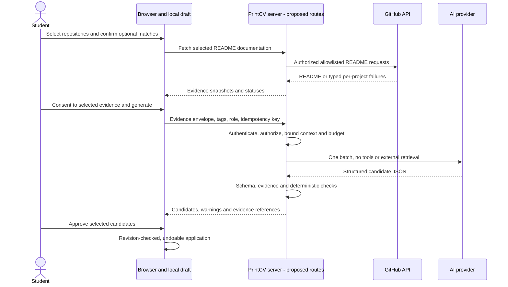
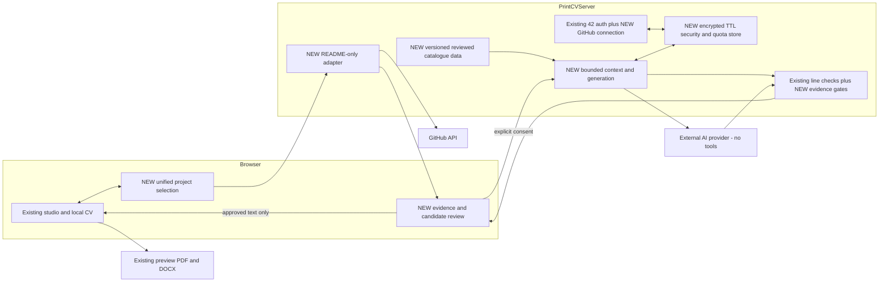

# PrintCV — Repository Audit & Ultra Master Plan

**Audit date:** 6 November 2026. **Status:** Planning only; implementation requires approval.

## 1. Executive Summary

Audit synthesis follows below. The working baseline is the existing, modified `enforce_template_format` worktree, not the separate Desktop `main` checkout. Historical plans are hypotheses until checked against this baseline.

## 2. Audit Metadata & Evidence

## 3. Verified Current Product / User Journey

## 4. Current Architecture & Source Map

## 5. Historical Plan Verification Matrix

## 6. Dr. Wissam Template Specification & Gap Matrix

## 7. Immediate Remediation Plan (Track A)

## 8. All Five Existing Validators

## 9. User Stories, Personas & Non-Goals

**PROPOSED acceptance stories:**

| Persona | Outcome | Essential acceptance |
|---|---|---|
| New 42 student, Level 0, no projects | Honest usable draft | No invented tools, bullets, graduation date or track; empty sections are valid |
| Core student with several passed projects | Choose the strongest evidence | Imported catalogue context remains distinguishable from personal claims |
| Advanced student or alumnus | Accurate education history | Status and dates derive from supported facts or explicit input, never level alone |
| Personal/freelance developer | Include non-42 work | Repository can stand alone without an Intra match; client/customer details remain optional |
| Student with private coursework | Keep coursework private | Selected-repository read access, no publication requirement, optional AI consent |
| Open-source contributor | Describe an actual contribution | Repository README is project context, not proof of contribution; no PR/diff ingestion |
| Returning CV owner | Keep edits through login and refresh | Existing content, omissions, order and notes survive; regeneration is a reviewable proposal |
| Shared-device user | Separate identities and local drafts | Account changes cannot merge two people; logout explains retained local data |

**REJECTED:** compulsory nonempty skills, automatic achievements, mandatory metrics invented to satisfy checks, compulsory GitHub login, source-code analysis, fine-tuning, implicit team ownership, forced one-page clipping, an unrelated landing-page redesign in Track A. **Non-goals:** ATS certification, guaranteed recruiter outcomes, automatic verification of truth, CV cloud synchronization, new microservices, embeddings/vector stores, autonomous browsing models, additional providers in the initial build.

## 10. Future Four-Step UX / State Flows (Track B)

Everything in this section is **PROPOSED**, not existing functionality.

### Step 1 — Start or return

1. Offer **Continue with 42** and the existing manual editing path. Wait for persistence hydration before importing anything.
2. Authentication cancellation returns to the same draft. An expired/failed login leaves the CV editable with **Try signing in again**.
3. Compare authenticated account identity with draft ownership. For a different account, offer **Keep this draft** / **Start a separate draft** after a recoverable snapshot; do not auto-merge. For an anonymous existing draft, ask whether to attach it.
4. For a returning same-account user, refresh source metadata only. Show newly discovered projects as suggestions. Never refill deliberately deleted content.

### Step 2 — Add GitHub access

Provide **Paste a public repository URL**, optional **Discover public repos from a profile**, and **Connect GitHub for private repositories**. A profile URL is discovery input, not authentication or proof of ownership. Connection can be skipped. Installation approval and organization SSO may require another administrator; explain this inline and let public/manual work continue.

Suggested disclosure: “GitHub grants read-only repository contents access to the repositories you select. PrintCV uses that access only to retrieve README documentation. AI processing is a separate choice.” Do not say GitHub itself grants a README-only permission.

### Step 3 — Select projects

Use a unified **Projects to include** screen with source chips (42, GitHub, manual), optional date, pairing state and README state. Include non-42/personal/freelance/open-source projects. Intra IDs and GitHub repository IDs identify separate records; one CV project can explicitly link them. Exact-looking names still produce suggestions, not ownership assertions. Show **Confirm match**, **Change repository**, **Keep separate**. Deduplicate by stable source IDs, not title alone. Permit a shared monorepo README to support multiple projects only with explicit association and separate evidence selection.

For an Intra-only project: “No repository linked. Add one, write manually, or keep the project without bullets.” For a GitHub-only project: “Not linked to 42 — you can still include this project.” Failed or unfinished coursework must be labeled honestly and only included deliberately; never call it validated. Preserve current CV selection until the user applies a reviewed change.

### Step 4 — Retrieve, generate, review

1. Fetch only selected permitted README documentation; each card progresses independently. Successful cards remain usable if another fails.
2. Show README excerpts that will be sent, optional target role and contribution confirmations. Tags start unchecked; absence of tags is allowed.
3. Before the first remote generation, name the chosen provider and describe selected README excerpts, catalogue context, confirmed tags and target role. Offer **Generate suggestions** and **Continue without AI**. Cancel means no provider request.
4. Submit one bounded request for the eligible selected projects. Show **Preparing evidence → Writing suggestions → Checking lines → Ready to review**. Do not imply actual streaming progress if only a request spinner is available.
5. Review per-project candidates with evidence links, attribution status and exact line-check results. Approve individually, edit, discard, or regenerate selected candidates. No automatic insertion.
6. Applying candidates is one undoable transaction with an expected draft revision. If the CV changed during generation, retain suggestions and ask where to apply; never overwrite newer text. Append is the default. Replace requires a visible diff and deliberate choice.
7. Leaving the flow preserves approved CV content. In-flight responses carry a generation ID; cancellation or account switching makes late results inapplicable. Reload restores consented local suggestions without running inference again; private source text is not persisted by default.



## 11. 42 OAuth & Project Catalogue Strategy

**UNKNOWN external contract:** unauthenticated requests to the official getting-started and projects API documentation redirected to a sign-in page during this audit. No login was attempted. The older plan's “2 requests/second, 1,200/hour”, permissions for global catalogue synchronization, licensing and completeness of embedded `projects_users` are not independently verified. Treat these as release prerequisites for a future sync, not operating guarantees.

**PROPOSED:** keep the current 42 login architecture for Track A except bounded, separately reviewed data-integrity corrections. The future selector needs source project status, cursus IDs, repeat/attempt identity and dates preserved rather than a single flattened list of passed names. Verify actual API pagination and resource schemas using approved documentation and synthetic fixtures before adding authenticated calls. Filter status from API fields; exam/piscine name heuristics are only fallback classification and should be labeled as such. Do not infer a GitHub URL, authorship, tools or specialization from a project name.

Catalogue options:

| Approach | Value | Problem | Decision |
|---|---|---|---|
| Curated versioned data shipped with app | No runtime quota, easy review, explicit sources | Requires maintenance; incomplete global coverage | Initial baseline |
| Central periodic authorized API sync | Stable IDs and broader metadata | API access, quotas, licensing and operational ownership unverified | Defer until verified |
| Hybrid API metadata + reviewed original summaries | Broader coverage without copying assignment text | More validation and reconciliation | Upgrade path |

Catalogue entries: `projectId`, `slug`, `aliases`, `displayName`, `cursusIds`, `catalogVersion`, `sourceUrl`, `sourceKind`, `retrievedAt`, `reviewedAt`, `description`, `requiredTechnologies`, `optionalTechnologies`, `contributionSuggestions`, and `rightsStatus`. Optional technology is never a student skill. A requirement such as zero leaks is never a measured student result. Omit `standardMetrics` from the old proposal. Unknown projects remain selectable and use README/manual context without a fabricated fallback. Catalogue entries are inference context, not training data. Initially import the reviewed data directly; a public catalogue API is unnecessary unless payload size or independent updates justify it. Future synchronization must be one centrally bounded job, not a catalogue crawl at every login.

## 12. GitHub Auth/Repo Matching/README-Only Retrieval

### Access decision

**VERIFIED external documentation:** GitHub OAuth `repo` grants read/write access to private and public repositories; `public_repo` also grants write capabilities. Neither meets the stated least-privilege requirement for private coursework. GitHub App Contents **read** permits the README endpoint. A GitHub App user access token is constrained by the intersection of app permissions, installation scope and user access [E1–E5].

| Option | Permissions and selection | Friction / maintenance | Decision |
|---|---|---|---|
| Public URL, no authorization | Public metadata/README only | Lowest friction; server IP quota shared | Support first |
| GitHub App | Contents read + required metadata; selected repositories; user authorization plus installation | More setup and organization approval states | Recommended private path |
| OAuth App with `repo` | Broad read/write private access; no equivalent private read-only scope | Simpler tutorial flow but violates requirement | Rejected for private access |

Use server-mediated GitHub App user authorization for private reads. An installation ID supplied by a browser is not authority. Do not use an installation token to bypass the user's own access. Account linkage must bind the 42/local session, GitHub numeric user ID, installation selection and one-use OAuth transaction. Expiring GitHub App user tokens are documented as eight hours with rotating six-month refresh tokens; choose a shorter PrintCV connection lifetime and explicit reconnect for the first release rather than retaining refresh tokens indefinitely. If durable refresh is later approved, serialize refreshes and securely rotate encrypted records; do not copy the current signed-profile cookie design for secrets.

### README-only contract

**VERIFIED external caveat:** `GET /repos/{owner}/{repo}/readme` promises the **preferred** README, with a default-branch `ref`; it does not promise root-only. GitHub's README display rules recognize `.github`, root and `docs`, prioritizing `.github` [E1, E6]. Do not rely on the endpoint name to prove root scope.

**PROPOSED initial policy:** root `README.md` only, matching the owner's literal requirement. Call the fixed Contents path `/repos/{owner}/{repo}/contents/README.md` with explicit JSON media type and default branch. Do not enumerate directories or recursively search. Root naming variants (`readme.md`, `README.MD`, `README.markdown`, `README`) are an owner-approved extension, probed through a small fixed ordered allowlist only; never a general content path. Alternatively the preferred README endpoint can be evaluated later with a strict returned-path check, but a nested response must never become model evidence. No nested README fallback. No manifests, source, issues, PRs, diffs, archives, trees, code search, linked images or remote documents.

The Contents API can dereference symlinks to normal files [E1]. Therefore a fixed `README.md` path alone does **not** establish physical blob provenance. Include a symlink fixture and reject explicit symlink/submodule/target responses; if the API hides dereferencing, do not claim a hard physical-source guarantee. Resolve this release gate with the owner: documentation-path semantics, or an approved metadata-only check of the selected README entry sufficient to reject symlinks (without fetching any non-README content). No quiet expansion of the boundary.

Validation pipeline:

1. Parse `https://github.com/owner/repo` with a URL parser; allow an optional `.git` suffix. Reject credentials, custom ports, lookalike hosts, encoded slashes/path traversal, unsupported enterprise hosts, blob URLs and arbitrary ref/path queries. Profile URLs belong to discovery, not repository retrieval.
2. Resolve accessible metadata and numeric repository ID through the appropriate public/user-authorized API. A client `isPrivate` flag is never trusted. Follow only bounded, revalidated GitHub API redirects for repository renames, and reauthorize the resolved ID.
3. Fetch the allowlisted README path. Request JSON, validate `path`, `name`, type, encoding and declared size; stream-bound the response as well. Do not blindly follow `download_url`.
4. Proposed decoded source cap: 64 KiB; JSON envelope cap: 128 KiB; request deadline: 10 seconds. Reject oversized/unsupported/binary/LFS-pointer/invalid UTF-8 content with a specific reason. These are proposed product limits, not GitHub limits. The API's much larger supported-file limits do not set the app's budget.
5. Decode only supported base64 UTF-8, normalize line endings and retain a source hash plus exact normalized evidence offsets. Strip HTML/comments from model context, disable images and link fetching, and render review text as escaped plain text. README embedded source code blocks are omitted from the AI context under the no-source-upload policy; retain prose surrounding them. Secret-pattern detection is best-effort, not proof that a README contains no secrets; show the outbound excerpt for review.
6. Use compact excerpt selection, not invisible truncation. If context is too large, mark omitted sections and let the user select a smaller excerpt or fewer projects. A complete source may be too large to import even if a smaller quoted excerpt would fit the model.

### Per-project state machine and exact retries

`manualRetriesUsed` starts at 0 **after an initial lookup**, with three remaining. Increment once when a manual retry request is dispatched; disable the button while in flight and deduplicate double clicks. Do not decrement for rendering, reload, focus or an automatically retried transport request. The third retry may succeed; only a failed third retry becomes exhausted. Persist attempt metadata, not private README text, for the same account/repository/default-branch/path selection. Re-selecting the same repository or reloading must not reset the counter. Changing to a genuinely different source creates a new cycle. Reauthorization resumes that source with its existing counter; a separate explicitly labeled later import session can reset it under server abuse limits.

| State | Meaning / copy | Allowed next actions |
|---|---|---|
| `idle` | “Ready to check README” | Initial check, skip |
| `checking` | “Checking README…” | Cancel; no duplicate retry |
| `ready` | “README ready” | Inspect, generate, remove |
| `missing` | “README.md not found. Add it to the repository root.” | **Retry — 3 / 2 / 1 remaining**, change repo, skip |
| `auth_required` | “Connect GitHub or grant access to this repository.” | Connect, reconnect, change, skip |
| `inaccessible` | “Repository unavailable or access was revoked.” | Reauthorize, change, skip; do not claim definite absence |
| `rate_limited` | “GitHub limit reached. Try after [time].” | Wait until provider reset, skip; no busy-loop |
| `transient_error` | “GitHub could not be reached. Other projects are ready.” | Bounded retry, change, skip |
| `unsupported` | “README cannot be imported: [size/encoding/path reason].” | Fix README, choose another, manual writing |
| `invalid_link` | “Enter a GitHub repository URL.” | Edit URL |
| `exhausted` | “Three retries used. Choose another repository or continue manually.” | Change, skip, manual writing |
| `skipped` | “Skipped” | Undo skip; existing counter retained |

Classify `401` as expired/invalid authentication. Inspect `403/429`, rate headers and provider error before deciding rate limit versus forbidden access. `404` can hide a private repository: only show confirmed missing after repository access has been established; a concurrent revocation can still make the result ambiguous, so recheck access when needed. Use at most two transport retries with jitter for network/5xx failures, within a deadline; no automatic retry of confirmed missing. Respect `Retry-After`/reset for rate limits rather than spending the missing-file retry budget. Initial + manual requests is at most **four logical README lookup rounds**; transport retries and any approved variant probes are separately bounded and instrumented. One project's failure never clears another's `ready` result.

## 13. AI Writing Specification & Evidence Rules

**PROPOSED `PRINTCV_AI_WRITING_SPEC_V1`:** one pure versioned specification in `src/lib/ai/writing-specification.ts`, reused by context construction and the optional manual helper. Keep the current deterministic rule implementation in place; no gratuitous validator relocation.

Rules:

- Produce zero to two useful candidate lines per project, defaulting to one where evidence is thin. No minimum; two to three is not a mandatory template invariant. User-approved additional content remains editable, with overflow guidance.
- Plain professional English, one concrete point per line; vary verbs without exaggeration. Prefer action + implementation + method + supported result, omitting unsupported components.
- Respect the exact current length/pronoun/verb/number/originality checks. A passing regex is not evidence of truth.
- README facts establish what documentation says. Catalogue facts establish a project requirement/context. Neither proves the student's individual contribution, measured performance, completion or proficiency.
- Confirmed contribution tags establish a user assertion, not independent verification. Record that distinction. Never silently equate “project used Docker” with “student knows Docker”.
- No invented deployment, customers, tests, team sizes, speedups, percentages, leak counts or ownership. Technical digits such as `HTTP/1.1` may pass the existing numeric check but are not impact metrics.
- Without attribution evidence, return a project-level description candidate marked `needs_confirmation`; do not call “Co-engineered” or “Implemented” neutral ownership language. If neutral wording fails the action rule, retain it as a separate project description suggestion, not an accepted achievement bullet.
- README text, catalogue text and tags are untrusted data. Model receives no tools, URLs to fetch, code execution, secrets, contact fields or the full CV. Do not use search grounding.
- Return only bounded JSON matching the schema; no markdown, hidden instructions, arbitrary project IDs, arbitrary HTML or generated URLs.

**Illustrative contract, not production code:**

```ts
type EvidenceAnchor = {
  id: string;
  kind: "readme" | "catalogue" | "user_confirmation";
  sourceId: string;
  contentHash: string;
  start: number; end: number; // normalized UTF-16 offsets into the chosen evidence text
  quote: string;
};
type BulletCandidate = {
  id: string; projectId: string; text: string;
  evidenceIds: string[];
  claimKind: "project_description" | "personal_contribution" | "quantitative_result";
  attribution: "unconfirmed" | "user_confirmed";
  numericClaims: { text: string; evidenceIds: string[] }[];
  state: "needs_confirmation" | "needs_evidence" | "needs_edit" | "ready_for_review";
  warnings: string[];
};
```

Server assigns candidate IDs and validates project/evidence IDs against its request context. Server—not the model—computes checks and final review state. Check quote/offset consistency, source version and numerical claims; unsupported or mismatched anchors fail closed. Exact quotes establish source association, not semantic entailment or truth. Human review remains necessary. Catalogue-only quantitative claims cannot become personal performance results. Include a warning when a source contains conflicting claims rather than choosing the more impressive one.

## 14. Deterministic Validation, Repair & Editor Integration

**PROPOSED pipeline:** bounded response → JSON/schema validation → project/evidence allowlists → source-anchor verification → claim/attribution rules → current `runLineChecks` → candidate review → revision-checked apply. Revalidate after every user edit and immediately before apply. Any sanitizer that changes text invalidates previous validation and evidence association; show the diff and rerun checks. Never “fix” a claim by changing its number.

Keep four orthogonal properties: **format check result**, **evidence support**, **attribution status**, **user approval**. Five green checks do not mean “verified”. `ready_for_review` is not `approved`; generation never writes directly into `bulletPoints`.

### Required number versus truthful prose

| Policy | Result | Recommendation |
|---|---|---|
| Preserve current numeric rule; missing evidence stays pending | No silent policy change; some truthful candidates cannot reach all-green state | Initial Track B baseline |
| Owner-approved numeric warning/reward instead of hard candidate acceptance requirement | More natural truthful prose, consistent messaging required across score/helper/editor | Preferred later product decision after review |
| Invent counts, substitute catalogue requirements, insert `[X]`, or exploit version digits to look quantified | Misleading CV, even if regex passes | Rejected |

Until the owner chooses otherwise, a candidate without a defensible number remains `needs_evidence` and outside the generated-acceptance path; manual existing editing/export behavior is not silently tightened. Ask “Do you have a real measure to add? You can also keep writing manually.” No modal or mandatory questionnaire for every project. If the owner approves a warning policy, version the rule contract and update copy/tests consistently; do not merely change the prompt.

Start with **zero automatic AI repair calls**. Allow one **user-requested batched** repair for formatting-only failures after evidence is available, using the same evidence, budget and schema. No one-call-per-bullet loop; no retries to manufacture numbers, attribution or absent sources. Recheck everything after repair. Preserve rejected candidates separately from accepted lines for undo/review, bounded by local retention consent.

Map approved text into existing string-array CV bullets through one store action. Keep candidate IDs and provenance in an optional sidecar keyed by stable bullet identity/text hash; array indices alone are unsafe after editing/reordering. Manual edits mark provenance stale rather than retaining an invalid “verified” badge. Full stable bullet objects can wait until justified by editor work; do not rewrite the entire CV schema merely to introduce AI.

## 15. Data Model, API Contracts & Persistence

**PROPOSED minimum extensions:** `DraftIdentity`, `SourceProject`, `RepositoryLink`, `ReadmeAttempt`, `EvidenceEnvelope`, `GenerationDraft`, `BulletProvenance`. Do not collapse an Intra project and a repository into a single identifier.

| Model | Minimum fields | Storage |
|---|---|---|
| Draft identity | draft ID, optional 42 account ID, revision, schema version | Browser local; import decision for legacy anonymous drafts |
| Source project | source kind/ID, cursus/status/date, observedAt, catalogue version | Browser metadata; authenticated source values separate from edits |
| Repository link | GitHub numeric repo ID, canonical owner/name, confirmed pairing IDs, access snapshot | Browser metadata; authorization always recomputed server-side |
| README attempt | account/repo/path/ref key, state, manualRetriesUsed, lastError, retryAt | Browser metadata, server abuse limits |
| Evidence envelope | source hash/path, exact permitted excerpt, anchors, fetchedAt, expiry, account-bound signature | Browser memory; bounded sealed proof for server round trip |
| Generation draft | generation ID, draft revision, context hash, spec/model/validator versions, candidates | Browser memory; optional local save with clear private-data disclosure |
| Provenance | candidate/bullet ID, text hash, evidence references, claim status, approval/edit timestamps | Optional browser sidecar; text survives unsupported readers |
| GitHub connection | user/session IDs, encrypted token, expiry, installation linkage | Server-only TTL record; opaque secure cookie in browser |

The README fetch route can return an account-bound HMAC evidence envelope over the exact normalized excerpt/hash/metadata with a short expiry (proposed 15 minutes). Generation verifies that proof rather than trusting client `readmeSha` or arbitrary pasted “GitHub evidence”. This avoids retaining raw READMEs in a database between calls. Treat user-edited/manual evidence as user assertions with a separate provenance type. HMAC provides integrity, not confidentiality; use TLS and avoid logging the envelope. A signed old source remains a historical snapshot, not proof of current access: reauthorize private repository access before remote generation.

### Proposed routes

All paths below are **new**, except the existing 42/session routes. Mutating/paid routes require session authentication, same-origin checks and CSRF protection. Use `Cache-Control: private, no-store` for user-specific responses; strict JSON size/type validation, timeouts and typed errors. Never trust client ownership/private flags.

| Route | Request | Response / authority |
|---|---|---|
| `GET /api/auth/github/login` | Server-created transaction and safe return location | OAuth redirect, one-use state bound to current session |
| `GET /api/auth/github/callback` | `code`, `state` | Exchange server-side, validate GitHub user, opaque connection cookie, safe redirect |
| `DELETE /api/auth/github` | CSRF token | Revoke token where supported, delete connection and scoped caches; local CV retained |
| `GET /api/github/repos` | Bounded cursor or public username | `{repositories:[{id,owner,name,visibility,defaultBranch}],nextCursor}`; enumerate only accessible metadata |
| `POST /api/projects/fetch-readme` | `{repositoryId?,url?,selectionId,requestId}` | `{state,source?,evidenceEnvelope?,retryAt?,error?}`; source contains approved README excerpt/hash/path |
| `POST /api/ai/generate-bullets` | `{generationId,draftRevision,evidenceEnvelopes,confirmedContributions,targetRole?,specVersion}` plus idempotency key | `{generationId,contextHash,results:[{projectId,candidates,checks,warnings}],usage}` |

Error envelope: `{code, message, projectId?, retryAt?, requestId}`. Use `400` invalid input, `401` unauthenticated, `403` denied authorization/consent, `409` idempotency input conflict, `413` oversized, `422` unsupported evidence/schema, `429` budget/rate limit and `502/503/504` bounded upstream failures. A valid batch with per-project failures returns its successful results and typed failures; it does not discard the whole batch. No endpoint accepts an arbitrary URL for server fetching.

### Migration boundaries

Track A should avoid a blanket content migration. For unknown legacy provenance, preserve existing values and explicit blanks; show source updates as optional import proposals. Any later schema bump must read old drafts without dropping unknown keys, retain a recoverable pre-upgrade snapshot, and test old-version rollback. Do not infer “empty means never edited”. Optional sidecars are additive; accepted CV text remains readable by the old editor. Stable IDs require careful mapping for duplicate identical lines, not a hash-only identity assumption. Account identity and “deliberately deleted” markers may require a small additive schema change in Track A; that does not authorize GitHub/AI fields early.

## 16. Security, Privacy, Consent & Threat Model

**PROPOSED trust boundaries:** browser local CV is user-controlled data; PrintCV server authenticates/authorizes fetches and holds secrets; 42 supplies profile records; GitHub supplies untrusted repository documentation; the AI provider receives only consented evidence; PDF/DOCX contain approved CV text. None of these boundaries grants proof of personal authorship.

| Threat | Control and acceptance evidence |
|---|---|
| Stolen/XSS-accessible browser state | No GitHub/model tokens in JS/localStorage; safe text rendering, CSP review, short session TTL; simulated XSS cannot extract server token |
| Cross-user repository access / installation-ID forgery | User-scoped authorization and repo ID checks on fetch AND generation; Alice cannot fetch Bob's private README |
| OAuth/login CSRF or account confusion | One-use, expiring, session-bound state; exact redirect allowlist; account change invalidates queued work |
| SSRF / redirect credential leak | Only constructed GitHub API requests; allowlisted redirects; no README links or raw arbitrary URLs followed |
| README prompt injection | Tool-less model; structured untrusted data, source/ID allowlists, no secrets in model context, escaped output; poisoned README cannot trigger network calls or mutate CV |
| HTML/Markdown script or image tracking | Plain text review or tightly sanitized inert Markdown; no external image fetch, no `dangerouslySetInnerHTML` from source |
| Fabricated but well-formatted claims | Separate evidence/attribution gates, exact anchors, review; unsupported metrics remain pending |
| Token replay and revoked access | Short TTL records, explicit disconnect, upstream authorization checks, connection epoch/cache invalidation |
| Cost abuse / duplicate requests | Atomic shared quotas and budget reservation, idempotency, bounded tokens/time; concurrent identical requests dispatch at most one provider call |
| Private source leakage in caches/logs | Account-scoped data, no shared public cache, redacted structured errors, no request-body analytics |
| Shared-device CV exposure | Explicit local-data retention copy and clear-device action; separate logout versus erase; never erase drafts silently |
| Provider retention / confidential README | Provider-specific paid terms and consent; disclose retention accurately; no promise of on-device-only AI |

**Proposed retention contract:** raw README/evidence text only during fetch/generation processing and browser memory; no server content logs or long-term source cache. Transient process memory is not guaranteed immediate secure erasure. Optional local suggestion persistence is opt-in for private projects, with a visible clear action. Store encrypted connection tokens for no longer than their provider expiry/PrintCV session limit (initially up to eight hours), and erase at disconnect. Store content-free idempotency/quota metadata for 24 hours; aggregate operational counters for 30 days if approved. These are proposed settings requiring deployment review, not claims about existing hosting. Logout/account change clears connection/suggestion memory; local CV deletion is an explicit separate action. Deleting PrintCV copies does not imply deleting provider abuse-monitoring logs.

Consent copy must say: “Your CV draft stays in this browser. If you choose AI suggestions, PrintCV sends the selected README excerpts, project context, confirmed contributions and optional target role to [provider]. READMEs may contain personal information. Review what will be sent. [Retention details].” Do not promise that no personal information can be sent merely because contact fields are excluded.

**VERIFIED provider terms [E9]:** the consulted Gemini terms distinguish paid and unpaid processing; unpaid use can include product improvement/human review and prohibits sensitive/confidential/personal input. Paid terms still allow limited abuse-monitoring retention. They also contain age and region restrictions relevant to a global student product. Therefore the old plan's free/zero-retention implications and immediate provider commitment are rejected. Confirm audience eligibility, supported regions, retention/DPA and paid configuration before selecting a provider. This does not change the current manual workflow during Track A.

## 17. Performance, AI Cost, Rate Limits & Caching

**PROPOSED controls:** initially up to six projects per request, 16,000 input tokens total and 2,400 billed output/thinking tokens where supported; one concurrent generation per account, 10 requests/hour and 30/day; 30-second generation deadline. These are starting budgets to validate with fixtures, not measured performance. If the schema/evidence cannot fit the output cap, return fewer suggestions or ask to reduce selection; never silently drop projects. Batch several projects in one interactive request; this is not the provider's delayed Batch API.

GitHub documents 60 unauthenticated requests/hour per originating IP, typically 5,000/hour for authenticated user requests, installation-specific limits, and secondary rate limits [E3]. Do not multiply one shared server IP's allowance by the number of students. Fetch selected sources lazily and serialize GitHub requests per connection initially; avoid polling on every keystroke. Respect pagination cursors and response headers. Use exact HTTP ETags for `If-None-Match`, **not the Git blob SHA**. Correctly authenticated 304s can avoid primary quota consumption; conditional requests are not universally free [E7].

Generation cache key includes account/draft scope, repo numeric IDs, README content/excerpt hashes, catalogue version, confirmed tags, target role, specification version, validator version and model/version/parameters. Changing any input invalidates suggestions; an unchanged reload does not regenerate. A private cached result must never be served across users or re-sent to a provider after access revocation. Accepted CV text remains the user's editable local draft. Keep raw private README caching memory-only initially; caching is a privacy decision, not just an optimization.

### Cost equation and scenarios

Let `N` = monthly requested generations, `h` = application result-cache hit fraction, `I/O` = billed input/output tokens, `Pi/Po` = USD per million tokens, `r` = repair fraction, and `Ir/Or` = repair tokens:

`Cmodel = N × (1-h) × [(I×Pi + O×Po) + r×(Ir×Pi + Or×Po)] / 1,000,000`.

Add token-store/quota-store requests, hosting, GitHub overhead, provider retries, monitoring and taxes separately. Include billed thinking tokens; do not count JSON text alone. An application cache hit is different from the provider's discounted prompt cache.

**VERIFIED price snapshot, not provider selection:** official Gemini pricing consulted 6 November 2026 lists Gemini 3.5 Flash-Lite standard text input at **$0.30/M** and output including thinking at **$2.50/M** [E8]. Recheck model availability, price and terms at build approval. The historical Gemini 2.0 Flash pricing is not the estimate basis.

| Scenario (assumptions, not observed usage) | N / hit rate | I / O per generation | Repair allowance (same-size conservative assumption) | Model-only monthly cost |
|---|---|---|---|---|
| Low | 1,000 / 40% | 3,000 / 500 | 5% | $1.35 |
| Medium | 10,000 / 50% | 8,000 / 1,200 | 10% | $29.70 |
| High | 100,000 / 20% | 16,000 / 2,400 | 15% | $993.60 |

The initial zero-auto-repair implementation is cheaper than these allowances. Worst-case allowed base request at this snapshot is $0.0108; one same-sized repair doubles it. Proposed launch budget: owner-approved **$50/month hard model cap** with warnings at 50/80/95%, plus a daily cap; high-volume scenarios must stop or obtain an explicitly increased budget. Reserve estimated worst-case spend atomically before dispatch and reconcile actual usage. If quota storage is unavailable, deny paid generation gracefully while leaving manual editing available. In-memory counters in independently scaled instances cannot enforce a global budget.

Measure synthetic and later consented pilot p50/p95 README and generation latency, provider errors, candidate rejection rate, cost per approved project, cache hits, and overflow incidence. Initial UX objective: immediate loading acknowledgement, cancel support, and useful partial progress. Do not claim “instant” or a measured latency SLA before testing.

## 18. Architecture Alternatives & Decision Matrix

All options retain browser-local CV editing and the existing renderer/export engines.

| Option | Accuracy / experience | Cost / privacy | Complexity / risk | Decision |
|---|---|---|---|---|
| A. Deterministic reviewed guides + confirmed contributions + existing manual helper | Predictable, no hallucinating model; less bespoke wording and more student input | Zero integrated inference; source can stay local | S–M; guide coverage and boilerplate duplication require care | Keep as fallback and viable no-cloud mode |
| B. Local editor + Next.js README/AI routes + small TTL security store | Few clicks, structured suggestions and review; model still not a fact verifier | Low bounded small-model cost; selected evidence leaves device | L overall, split into independent phases; auth/quota/provenance are real work | Recommended future baseline |
| C. Account-backed asynchronous import service + persistent jobs/sources | Cross-device history and larger imports; little immediate gain for one page | More retention and hosting cost; larger private-data footprint | XL; database/queue/deletion/operational burden | Defer unless measured demand justifies it |

For writing within option B, compare zero-model guides, **one** small-model batch and larger/multi-pass analysis against the same evidence fixtures. Larger models do not prove ownership, cannot cure missing metrics and raise cost/latency. Use a larger model only if a blinded quality evaluation shows material improvement that fits the approved budget. Never use full-repository analysis under any option.

**Why a small store rather than “purely stateless”:** existing local CV persistence does not require a CV database. However, robust distributed quotas, idempotency, one-use OAuth transactions and revocable private-token connections need shared atomic state. A small encrypted TTL store for security/operational metadata is justified for production Track B; it is not a user-CV database or a worker fleet. A public-only pilot may precede private auth, but paid AI still needs enforceable abuse controls. Select the actual service only after platform/runtime review and owner approval; no infrastructure change is authorized by this plan.



## 19. UX & Accessibility Specification

**PROPOSED requirements for touched screens:** semantic buttons/checkboxes and labels; visible focus; all selection, match confirmation, retry, reorder and review actions usable by keyboard. Modal dialogs require an accessible title, trapped focus, Escape handling and focus restoration; prefer an inline/wide panel for the multi-step importer rather than stacked modals. Announce per-project status changes in a polite live region, not one global assertive announcement per token. Errors remain attached with `aria-describedby`; icons/colors supplement text rather than replacing it.

At 320/360/375/390px and 200% zoom, actions wrap without horizontal document scrolling. CV preview may use an explicitly labeled scroll/scale viewport; text-entry controls must not shrink to illegibility. Keep edit/preview tabs available on mobile and avoid keyboard-obscured primary actions. Respect reduced motion. Use large touch targets and tested text/control contrast. Preserve focus on Retry after a failed request, or move to the newly available review action with an announced completion; do not jump to another card.

Copy examples:

- Empty skills: “Add skills you can confidently discuss. You can leave this blank.”
- Unconfirmed suggestion: “Project documentation mentions this. Confirm your contribution before using it as an achievement.”
- Number conflict: “No supported number found. Add evidence or continue writing manually.”
- Overflow: “This draft exceeds one A4 page. Review the highlighted sections or choose a denser layout. Your content has not been removed.”
- Edited during generation: “Your draft changed while suggestions were prepared. Review where to add them.”
- Cached suggestion: “Saved suggestion from [time], based on README [hash/date].”
- Revocation: “GitHub access has ended. Your existing CV is still available in this browser.”
- No cloud: “Write manually or copy a prompt to a service you choose. PrintCV will not send this evidence to an AI provider.”

Separate **format readiness**, **content completeness**, **evidence status** and **page fit**. A blank novice CV is incomplete, not dishonest or structurally invalid. Do not label five heuristic checks as truth verification or ATS certification.

## 20. QA/Test/Verification Plan

## 21. Phased Implementation Roadmap

## 22. Risks, Dependencies, Migration & Rollback Strategy

## 23. Decision Log / Architectural Decision Records

## 24. Open Questions Requiring Owner Approval

## 25. Top 10 Recommendations

## 26. Concise Build-Mode Handoff

## 27. Appendices / Evidence Index

### External documentation consulted (6 November 2026; public, unauthenticated)

- **E1** GitHub Contents and README APIs: https://docs.github.com/en/rest/repos/contents#get-a-repository-readme — preferred README, ref default, metadata/encoding, Contents symlink behavior.
- **E2** GitHub OAuth scopes: https://docs.github.com/en/apps/oauth-apps/building-oauth-apps/scopes-for-oauth-apps — `repo` and `public_repo` include write access.
- **E3** GitHub rate limits: https://docs.github.com/en/rest/using-the-rest-api/rate-limits-for-the-rest-api — public/authenticated quotas, reset headers and secondary limits.
- **E4** GitHub App user authorization: https://docs.github.com/en/apps/creating-github-apps/authenticating-with-a-github-app/authenticating-with-a-github-app-on-behalf-of-a-user — intersection of user/app/installation access.
- **E5** GitHub App permissions: https://docs.github.com/en/rest/authentication/permissions-required-for-github-apps#repository-permissions-for-contents — repository Contents read permissions. Token refresh: https://docs.github.com/en/apps/creating-github-apps/authenticating-with-a-github-app/refreshing-user-access-tokens.
- **E6** README location precedence: https://docs.github.com/en/repositories/managing-your-repositorys-settings-and-features/customizing-your-repository/about-readmes.
- **E7** Conditional requests, hidden private 404s and backoff: https://docs.github.com/en/rest/using-the-rest-api/best-practices-for-using-the-rest-api.
- **E8** Official pricing snapshot: https://ai.google.dev/gemini-api/docs/pricing — model/pricing are evaluation inputs, not an approved integration.
- **E9** Provider terms: https://ai.google.dev/gemini-api/terms — paid/unpaid handling, retention and audience/region constraints.
- **E10 — access blocked:** https://api.intra.42.fr/apidoc/guides/getting_started and https://api.intra.42.fr/apidoc/2.0/projects/index.html redirected to student sign-in. No authenticated documentation/API access attempted. One initially tried GitHub App documentation URL returned 404; E4 is the working canonical reference.

No live PrintCV or Cloudflare URLs were accessed. No production credentials were used.
