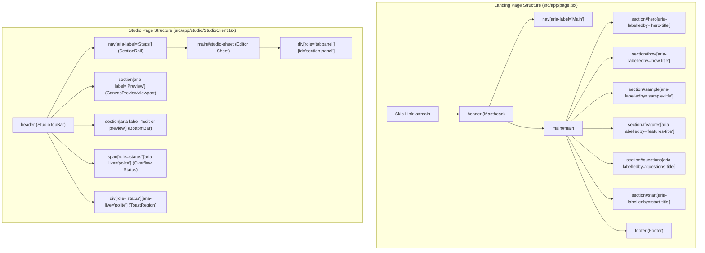
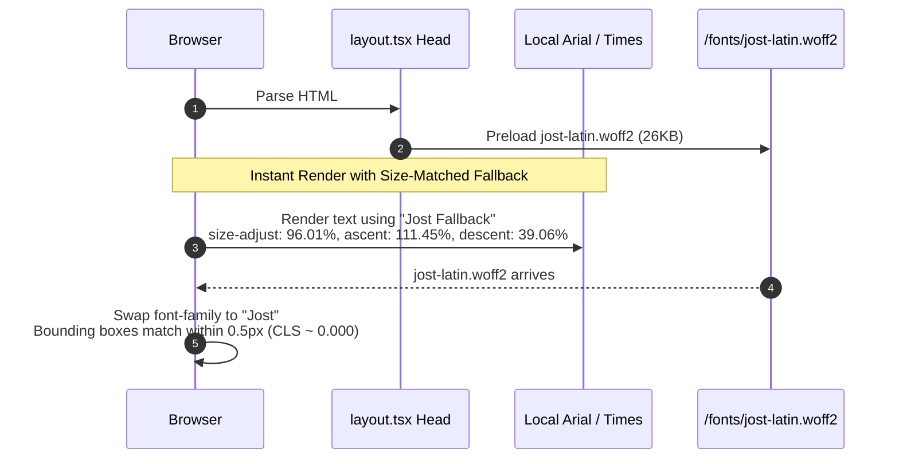

# PrintCV QA Audit Report: Accessibility & Performance Specialist (Agent 6)

**Audit Target**: PrintCV (`/home/alnassar/Desktop/printcv`)  
**Auditor**: Agent 6 — Accessibility & Performance Specialist  
**Standards Evaluated**: WCAG 2.1 AA / WAI-ARIA 1.2 / Web Vitals (LCP, CLS, INP, FID) / Impeccable Audit Protocol  
**Date**: November 2, 2026  
**Status**: Complete  

---

## 1. Audit Health Score & Executive Summary

### Audit Health Score

| # | Dimension | Score (0-4) | Key Finding |
|---|-----------|:-----------:|-------------|
| 1 | **Accessibility (A11y)** | **3 / 4** | Strong ARIA landmarks, dialog focus trap, and contrast; CV preview headings use `<div>` instead of `<h2>`, and global `0.01ms` motion kill is active. |
| 2 | **Performance** | **3 / 4** | Excellent font fallback metric matching (0 CLS) and dynamic `docx` import; unthrottled `ResizeObserver` in `CleanTemplate` cascades state updates on every keystroke. |
| 3 | **Theming** | **3 / 4** | Clean, semantic token system separating landing (`.lp`) and studio editor; no OS dark mode (`prefers-color-scheme: dark`) support. |
| 4 | **Responsive Design** | **4 / 4** | Fluid dual-pane architecture, strict mobile 44x44px touch targets below 640px, iOS zoom prevention (16px inputs), and container query scaling. |
| 5 | **Implementation Integrity** | **4 / 4** | Highly coherent, student-specific architecture with zero boilerplate shortcuts, authentic 42 project workflows, and disciplined UX rationale. |
| **Total** | | **17 / 20** | **Good (Address weak dimensions)** |

*Rating Bands: 18-20 Excellent (minor polish) | 14-17 Good (address weak dimensions) | 10-13 Acceptable (significant work needed) | 6-9 Poor (major overhaul) | 0-5 Critical (fundamental issues)*

---

### Implementation Integrity Verdict
**Verdict: PASS (Coherent, intentional, purpose-built architecture).**  
The implementation exhibits exceptional engineering discipline. Rather than relying on heavyweight third-party component libraries or generic template kits, PrintCV implements a bespoke, accessible design system tailored specifically to 42 students. Key verification points:
- Handcrafted WAI-ARIA tabs, modal dialogs, and toast queues with full focus traps, outside element `inert` management, and polite live regions.
- Authentic handling of 42 Intra profile imports, project slugs, and local browser persistence.
- Zero copy-paste drift or decorative placeholder content.

---

### Executive Summary

PrintCV scores **17/20 ("Good")** on the technical quality audit. The frontend demonstrates an unusually high baseline of accessibility awareness and web performance engineering:
1. **Accessibility Highlights**: Robust keyboard navigation with custom focus traps (`inertOutside` + `useDialog`), native WAI-ARIA tab lists with roving arrow key navigation, polite live region announcements for dynamic counts and score calculations, strict mobile touch target scaling (`>= 44px` below 640px), and passing contrast across all textual and status pill pairings.
2. **Performance Highlights**: Zero font layout shift via size-matched fallback overrides (`ascent-override`, `descent-override`, `size-adjust`), selective single-font preloading, dynamic chunk-splitting of heavy export engines (`docx`), and server-rendered landing page sections.

However, several critical and major technical gaps must be addressed prior to production release:
- **P1**: In [CVSheet.tsx](file:///home/alnassar/Desktop/printcv/src/components/templates/CVSheet.tsx#L143-L490), section headers (`Education`, `Experience`, `Selected Projects`, `Technical Skills`, `Relevant Coursework`, `Extracurricular Activities`) are rendered as `<div>` elements instead of semantic `<h2>` headings. Screen reader users navigating by heading landmarks cannot locate or jump between resume sections.
- **P1**: In [CVSheet.tsx](file:///home/alnassar/Desktop/printcv/src/components/templates/CVSheet.tsx#L127-L573), interactive section containers that support click-to-edit navigation (`onSectionClick`) lack `role="button"`, `tabIndex={0}`, and keyboard handlers (`onKeyDown`), preventing keyboard-only users from interacting with the preview.
- **P1**: In [globals.css](file:///home/alnassar/Desktop/printcv/src/app/globals.css#L76-L78), `@media (prefers-reduced-motion: reduce)` applies an indiscriminate wildcard `*, *::before, *::after { animation-duration: 0.01ms !important; transition-duration: 0.01ms !important; }`. This global reset destroys useful state change feedback (toasts, focus transitions, accordion reveals) and risks breaking asynchronous transition event lifecycles.
- **P2**: In [CleanTemplate.tsx](file:///home/alnassar/Desktop/printcv/src/components/templates/CleanTemplate.tsx#L29-L57), an unthrottled `ResizeObserver` reads `scrollHeight` and triggers React state updates in both `CleanTemplate` and `ReziStudioLayout` synchronously upon every keystroke, forcing full-tree layout thrashing.
- **P2**: In [Cta.tsx](file:///home/alnassar/Desktop/printcv/src/components/landing/Cta.tsx#L10-L13), `<section id="start" aria-labelledby="start-title">` points to a `<p>` tag rather than an accessible heading (`<h2>`).

#### Issue Count Summary
- **P0 (Blocking)**: 0
- **P1 (Major / WCAG AA Violations)**: 3
- **P2 (Minor / Performance & Usability Annoyances)**: 4
- **P3 (Polish / Best Practices)**: 3

---

## 2. Detailed Findings by Severity

### [P1] Semantic Headings Missing in CVSheet Template
- **Location**: [src/components/templates/CVSheet.tsx:143](file:///home/alnassar/Desktop/printcv/src/components/templates/CVSheet.tsx#L143), [line 236](file:///home/alnassar/Desktop/printcv/src/components/templates/CVSheet.tsx#L236), [line 309](file:///home/alnassar/Desktop/printcv/src/components/templates/CVSheet.tsx#L309), [line 395](file:///home/alnassar/Desktop/printcv/src/components/templates/CVSheet.tsx#L395), [line 437](file:///home/alnassar/Desktop/printcv/src/components/templates/CVSheet.tsx#L437), [line 485](file:///home/alnassar/Desktop/printcv/src/components/templates/CVSheet.tsx#L485)
- **Category**: Accessibility (Semantic HTML & Heading Structure)
- **Impact**: Screen reader users using heading navigation shortcuts (e.g., 'H' or '2' in NVDA, JAWS, or VoiceOver) cannot locate or jump directly to the CV's constituent sections. All section titles are rendered as styled `<div>` elements within `<section>` tags.
- **WCAG Standard**: WCAG 2.1 SC 1.3.1 Info and Relationships (Level A), SC 2.4.6 Headings and Labels (Level AA).
- **Recommendation**: Replace `<div className="font-bold uppercase tracking-wider text-gray-900 border-b border-gray-800 ...">` with `<h2 className="...">` across all section rendering methods (`renderEducation`, `renderExperience`, `renderProjects`, `renderSkills`, `renderCoursework`, `renderExtracurriculars`).
- **Suggested Command**: `$impeccable harden`

---

### [P1] Inaccessible Section Click-to-Edit in CVSheet Preview
- **Location**: [src/components/templates/CVSheet.tsx:127](file:///home/alnassar/Desktop/printcv/src/components/templates/CVSheet.tsx#L127), [line 220](file:///home/alnassar/Desktop/printcv/src/components/templates/CVSheet.tsx#L220), [line 293](file:///home/alnassar/Desktop/printcv/src/components/templates/CVSheet.tsx#L293), [line 379](file:///home/alnassar/Desktop/printcv/src/components/templates/CVSheet.tsx#L379), [line 421](file:///home/alnassar/Desktop/printcv/src/components/templates/CVSheet.tsx#L421), [line 469](file:///home/alnassar/Desktop/printcv/src/components/templates/CVSheet.tsx#L469), [line 566](file:///home/alnassar/Desktop/printcv/src/components/templates/CVSheet.tsx#L566)
- **Category**: Accessibility (Keyboard Navigation & Role Attributes)
- **Impact**: When `onSectionClick` is passed to `CVSheet` (in the studio canvas preview), sections render cursor styling and a "Click to edit" badge on hover, but have no `role="button"`, no `tabIndex={0}`, and no keyboard listeners (`onKeyDown` for Enter/Space). Keyboard users cannot discover or activate section editing from the document canvas.
- **WCAG Standard**: WCAG 2.1 SC 2.1.1 Keyboard (Level A), SC 4.1.2 Name, Role, Value (Level A).
- **Recommendation**: When `onSectionClick` is active, add `role="button"`, `tabIndex={0}`, `aria-label="Edit [Section Name] section"`, and an `onKeyDown` handler that triggers `onSectionClick` upon `Enter` or `Space`.
- **Suggested Command**: `$impeccable harden`

---

### [P1] Indiscriminate `0.01ms` Kill in Reduced Motion Media Query
- **Location**: [src/app/globals.css:76-78](file:///home/alnassar/Desktop/printcv/src/app/globals.css#L76-L78)
- **Category**: Accessibility (Motion Sensitivity & Feedback)
- **Impact**: The wildcard CSS override `*, *::before, *::after { animation-duration: 0.01ms !important; transition-duration: 0.01ms !important; scroll-behavior: auto !important; }` forcibly strips all transitions, including critical non-disorienting feedback (e.g. subtle opacity fades on toast dismissals, dialog backdrop reveals, and button active states). Furthermore, setting durations to 0.01ms causes frame skips and can disrupt asynchronous `transitionend` and `animationend` JavaScript callbacks.
- **WCAG Standard**: WCAG 2.1 SC 2.3.3 Animation from Interactions (Level AAA) / Impeccable Motion Standards.
- **Recommendation**: Remove the blanket `0.01ms` wildcard. Target only transform and large displacement animations (`translate`, `scale`, `rotate`, large physical movements) while preserving low-intensity opacity fades (e.g., 150ms opacity transitions) so state changes remain perceptible without vestibular distress.
- **Suggested Command**: `$impeccable polish`

---

### [P2] Synchronous Cascading Layout Reflow in CleanTemplate ResizeObserver
- **Location**: [src/components/templates/CleanTemplate.tsx:29-57](file:///home/alnassar/Desktop/printcv/src/components/templates/CleanTemplate.tsx#L29-L57)
- **Category**: Performance (Layout Thrashing & Unthrottled State Cascades)
- **Impact**: On every keystroke in any studio field, `useEffect` fires, rebinds a `ResizeObserver`, and immediately invokes `calculateBudget()`, which synchronously reads `innerContentRef.current.scrollHeight` (forcing a full browser reflow). It then synchronously updates local state (`setIsInternalOverflow`) and propagates `onHeightBudgetChange` to `ReziStudioLayout`, triggering re-renders of the top bar, navigation rail, bottom bar, and canvas viewport.
- **WCAG / Web Vitals**: Interaction to Next Paint (INP) degradation during rapid text input.
- **Recommendation**: Debounce or batch height measurements using `requestAnimationFrame`. Only notify `onHeightBudgetChange` when measured percentage or overflow status actually changes, rather than recalculating and updating state synchronously on every keypress.
- **Suggested Command**: `$impeccable optimize`

---

### [P2] Forced Synchronous Layout in TextArea fitHeight
- **Location**: [src/components/ui/TextArea.tsx:8-10](file:///home/alnassar/Desktop/printcv/src/components/ui/TextArea.tsx#L8-L10), [lines 16-18](file:///home/alnassar/Desktop/printcv/src/components/ui/TextArea.tsx#L16-L18)
- **Category**: Performance (Forced Synchronous Reflow)
- **Impact**: `useLayoutEffect` invokes `fitHeight` synchronously before paint whenever `value` updates. `fitHeight` writes `el.style.height = "auto"`, immediately reads `el.scrollHeight` (invalidating layout and forcing reflow), and writes `el.style.height = "${Math.max(minHeight, el.scrollHeight)}px"`. During rapid typing in bullet point lines, this causes per-keystroke layout thrashing.
- **WCAG / Web Vitals**: INP and main-thread responsiveness on lower-end mobile devices.
- **Recommendation**: Calculate height changes without resetting to `"auto"` if scrollHeight already matches clientHeight, or measure offscreen/use CSS grid-based auto-expanding textarea patterns (`field-sizing: content` with fallback).
- **Suggested Command**: `$impeccable optimize`

---

### [P2] Section Landmark Missing Heading in Landing Page CTA
- **Location**: [src/components/landing/Cta.tsx:10-13](file:///home/alnassar/Desktop/printcv/src/components/landing/Cta.tsx#L10-L13)
- **Category**: Accessibility (Semantic Structure & Heading Hierarchy)
- **Impact**: The CTA section `<section id="start" aria-labelledby="start-title">` uses a `<p id="start-title">` tag for its title. While technically valid ARIA, users navigating the document outline via heading shortcuts bypass this major section.
- **WCAG Standard**: WCAG 2.1 SC 1.3.1 Info and Relationships (Level A), SC 2.4.6 Headings and Labels (Level AA).
- **Recommendation**: Change `<p id="start-title" className="... text-step-lead font-medium">` to `<h2 id="start-title" className="... text-step-lead font-medium">`.
- **Suggested Command**: `$impeccable harden`

---

### [P2] Secondary Button Border Contrast on White Background
- **Location**: [src/components/ui/Button.tsx:13](file:///home/alnassar/Desktop/printcv/src/components/ui/Button.tsx#L13), [src/app/globals.css:21](file:///home/alnassar/Desktop/printcv/src/app/globals.css#L21)
- **Category**: Theming & Contrast (Non-Text Contrast)
- **Impact**: Secondary buttons use `border border-control` where `--control` is `#d6d6d6`. On white `--paper` (`#ffffff`), the contrast ratio is **1.45:1**, falling well below the 3.0:1 requirement for UI component boundaries. While the button text (`#232323`) provides 15.7:1 contrast, the visual boundary of the button is barely perceptible for users with low contrast sensitivity.
- **WCAG Standard**: WCAG 2.1 SC 1.4.11 Non-text Contrast (Level AA).
- **Recommendation**: Increase `--control` boundary contrast to at least `#8a8a8a` (3.45:1) for button borders or add subtle background differentiation (`bg-raised` `#f7f7f7`).
- **Suggested Command**: `$impeccable colorize`

---

### [P3] Form Inputs Lack Programmatic `aria-required` Attributes
- **Location**: [src/components/studio/sections/ContactSection.tsx:25-47](file:///home/alnassar/Desktop/printcv/src/components/studio/sections/ContactSection.tsx#L25-L47), [src/components/studio/sections/ProjectsSection.tsx:99-117](file:///home/alnassar/Desktop/printcv/src/components/studio/sections/ProjectsSection.tsx#L99-L117)
- **Category**: Accessibility (Forms & Assistive Technology)
- **Impact**: Required fields display visual asterisks in their labels (e.g. `label="Full name *"`), but the underlying `<TextInput>` elements lack `required` or `aria-required="true"`. Screen readers announce the label with "asterisk" rather than declaring the field explicitly as required.
- **WCAG Standard**: WCAG 2.1 SC 3.3.2 Labels or Instructions (Level A).
- **Recommendation**: Pass `required={true}` or `aria-required="true"` into `FieldA11y` props inside `Field.tsx` when the field is marked mandatory.
- **Suggested Command**: `$impeccable clarify`

---

### [P3] Mobile Navigation `<summary>` Padding Width
- **Location**: [src/components/landing/Masthead.tsx:31](file:///home/alnassar/Desktop/printcv/src/components/landing/Masthead.tsx#L31)
- **Category**: Responsive Design (Touch Target Ergonomics)
- **Impact**: The mobile `<details>` navigation summary has `px-1` and `h-11`. The "Menu" text is ~36px wide; with 8px horizontal padding, the total target width is ~44px. While technically meeting the 44px threshold, touch accuracy at the top right edge of mobile screens benefits from a more generous bounding box.
- **WCAG Standard**: WCAG 2.1 SC 2.5.8 Target Size (Minimum) (Level AA).
- **Recommendation**: Increase padding from `px-1` to `px-3` (`min-w-[48px]`).
- **Suggested Command**: `$impeccable adapt`

---

### [P3] Score Bar in ScoreReceipt Lacks Explicit Progressbar Semantics
- **Location**: [src/components/landing/ScoreReceipt.tsx:19](file:///home/alnassar/Desktop/printcv/src/components/landing/ScoreReceipt.tsx#L19)
- **Category**: Accessibility (Semantic Markup)
- **Impact**: In `ScoreReceipt.tsx`, the score bar is marked as a visual container `<div className="mt-3 h-2 bg-bar"><div className="h-full bg-data" style={{ width: `${score.total}%` }} /></div>`. In contrast, `ScoreEngineModal.tsx` properly implements `role="img" aria-label="Score X out of 100"`.
- **WCAG Standard**: WCAG 2.1 SC 1.1.1 Non-text Content (Level A).
- **Recommendation**: Add `role="progressbar" aria-valuenow={score.total} aria-valuemin={0} aria-valuemax={100} aria-label="CV Score"` or `aria-hidden="true"` to prevent redundant ambiguous container traversal.
- **Suggested Command**: `$impeccable clarify`

---

## 3. Deep Dive Domain 1: Accessibility (WCAG 2.1 AA)

### 3.1 Semantic HTML & Landmarks

PrintCV exhibits clean landmark discipline across both landing and studio pages:



#### Landmarks Evaluation
- `<header>`: Present in [Masthead.tsx:14](file:///home/alnassar/Desktop/printcv/src/components/landing/Masthead.tsx#L14) and [StudioTopBar.tsx:45](file:///home/alnassar/Desktop/printcv/src/components/studio/StudioTopBar.tsx#L45).
- `<nav>`: Present with unique accessible names: `<nav aria-label="Main">` in [Masthead.tsx:15](file:///home/alnassar/Desktop/printcv/src/components/landing/Masthead.tsx#L15) and `<nav aria-label="Steps">` in [ReziStudioLayout.tsx:328](file:///home/alnassar/Desktop/printcv/src/components/studio/ReziStudioLayout.tsx#L328).
- `<main>`: Properly anchored with `<main id="main">` in [src/app/page.tsx:20](file:///home/alnassar/Desktop/printcv/src/app/page.tsx#L20) and `<main id="studio-sheet">` in [ReziStudioLayout.tsx:334](file:///home/alnassar/Desktop/printcv/src/components/studio/ReziStudioLayout.tsx#L334).
- `<footer>`: Semantic `<footer>` landmark present in [Footer.tsx:9](file:///home/alnassar/Desktop/printcv/src/components/landing/Footer.tsx#L9).

#### Heading Hierarchy Analysis
- **Landing Page**:
  - `h1`: Single `h1 id="hero-title"` in [Hero.tsx:27](file:///home/alnassar/Desktop/printcv/src/components/landing/Hero.tsx#L27) ("Your 42 projects, on one clean page").
  - `h2`: `h2 id="how-title"` in [HowItWorks.tsx:73](file:///home/alnassar/Desktop/printcv/src/components/landing/HowItWorks.tsx#L73), `h2 id="sample-title"` in [Showcase.tsx:42](file:///home/alnassar/Desktop/printcv/src/components/landing/Showcase.tsx#L42), `h2 id="features-title"` in [Facts.tsx:16](file:///home/alnassar/Desktop/printcv/src/components/landing/Facts.tsx#L16), `h2 id="questions-title"` in [Faq.tsx:25](file:///home/alnassar/Desktop/printcv/src/components/landing/Faq.tsx#L25).
  - `h3`: FAQ individual questions in [Faq.tsx:29](file:///home/alnassar/Desktop/printcv/src/components/landing/Faq.tsx#L29).
  - `Hero.tsx` Mockup Isolation: In [Hero.tsx:63](file:///home/alnassar/Desktop/printcv/src/components/landing/Hero.tsx#L63) and [Showcase.tsx:32](file:///home/alnassar/Desktop/printcv/src/components/landing/Showcase.tsx#L32), the embedded `CVSheet` passes `nameAs="p"`, intentionally downgrading the candidate's name to a paragraph so that it does not compete with the page's primary `<h1>`.
- **Studio Page**:
  - `h1`: Rendered dynamically by `SectionTitle` in [parts.tsx:25](file:///home/alnassar/Desktop/printcv/src/components/studio/sections/parts.tsx#L25) (`<h1 tabIndex={-1} className="text-app-title">`).
  - `h2`: Used for sub-lists (e.g. [ProjectsSection.tsx:140](file:///home/alnassar/Desktop/printcv/src/components/studio/sections/ProjectsSection.tsx#L140) "Your other 42 projects", [ActivitiesSection.tsx:42](file:///home/alnassar/Desktop/printcv/src/components/studio/sections/ActivitiesSection.tsx#L42) "Courses and certificates", [ActivitiesSection.tsx:74](file:///home/alnassar/Desktop/printcv/src/components/studio/sections/ActivitiesSection.tsx#L74) "Activities").
  - `h3`: Used for nested items within activities in [ActivitiesSection.tsx:85](file:///home/alnassar/Desktop/printcv/src/components/studio/sections/ActivitiesSection.tsx#L85).

---

### 3.2 Keyboard Navigation & Focus Management

#### Focus Trap & Dialog Architecture
In [src/lib/use-dialog.ts](file:///home/alnassar/Desktop/printcv/src/lib/use-dialog.ts), PrintCV provides a custom dialog controller:
1. **`inertOutside` ([use-dialog.ts:10-22](file:///home/alnassar/Desktop/printcv/src/lib/use-dialog.ts#L10-L22))**:
   - Walks up the DOM tree from the dialog element and sets `sibling.inert = true` on all sibling nodes.
   - Screen reader virtual cursors cannot escape the dialog; mouse clicks outside are ignored.
   - Restores `.inert = false` cleanly when the dialog unmounts.
2. **Keyboard Trapping ([use-dialog.ts:41-67](file:///home/alnassar/Desktop/printcv/src/lib/use-dialog.ts#L41-L67))**:
   - Filters all focusable elements using `a[href], button:not([disabled]), textarea:not([disabled]), input:not([disabled]), select:not([disabled]), [tabindex]:not([tabindex="-1"])`.
   - Wraps Tab from the last element to the first element; wraps Shift+Tab from the first element to the last element.
   - Handles `Escape` key to invoke `onClose()`.
   - Caches `opener = document.activeElement` and returns focus via `opener.focus({ preventScroll: true })` upon closing.
3. **Full-Screen Preview Focus Management ([CanvasPreviewViewport.tsx:115-124](file:///home/alnassar/Desktop/printcv/src/components/studio/CanvasPreviewViewport.tsx#L115-L124))**:
   - When entering full-screen canvas preview mode, `inertOutside(zoneRef.current)` is executed.
   - An Escape key listener restores normal view.
   - On exit, focus is explicitly returned to `fullScreenButtonRef.current`.

#### Focus Visible Indicators
- In [globals.css:45](file:///home/alnassar/Desktop/printcv/src/app/globals.css#L45):
  `:focus-visible { outline: 2px solid var(--ink); outline-offset: 2px; }`
- In [globals.css:46](file:///home/alnassar/Desktop/printcv/src/app/globals.css#L46):
  `.on-ink :focus-visible { outline-color: var(--mint); }`
- Internal Negative Offset: In scrolling tabs and preview zones ([SectionRail.tsx:96](file:///home/alnassar/Desktop/printcv/src/components/studio/SectionRail.tsx#L96), [ScoreEngineModal.tsx:156](file:///home/alnassar/Desktop/printcv/src/components/studio/ScoreEngineModal.tsx#L156), [CanvasPreviewViewport.tsx:204](file:///home/alnassar/Desktop/printcv/src/components/studio/CanvasPreviewViewport.tsx#L204)), `focus-visible:outline-offset-[-2px]` ensures focus rings are never clipped by `overflow: hidden` / `overflow: auto` boundaries.

#### Scrollable Container Focusability
- In [CanvasPreviewViewport.tsx:203](file:///home/alnassar/Desktop/printcv/src/components/studio/CanvasPreviewViewport.tsx#L203):
  `<div ref={bodyRef} role="group" aria-label="Page preview" tabIndex={scrolls ? 0 : undefined} ...>`
  The preview body dynamically assigns `tabIndex={0}` *only when its contents exceed the viewport* (`scrolls === true`), enabling keyboard arrow key scrolling while avoiding unnecessary tab stops when the whole page fits.

---

### 3.3 Screen Reader Compatibility & ARIA Patterns

| Component | Pattern | Implementation Details | Evidence |
|-----------|---------|------------------------|----------|
| **OutputIndex** | WAI-ARIA Tabs | `role="tablist"`, `role="tab"`, `aria-selected`, `aria-controls`, `role="tabpanel"`, `aria-labelledby`, roving arrow navigation (Left/Right/Home/End) | [OutputIndex.tsx:18-34](file:///home/alnassar/Desktop/printcv/src/components/landing/OutputIndex.tsx#L18-L34) |
| **SectionRail** | WAI-ARIA Tabs | `role="tablist" aria-label="Sections"`, `role="tab"`, roving focus, tab panel connection to `#section-panel` | [SectionRail.tsx:88-109](file:///home/alnassar/Desktop/printcv/src/components/studio/SectionRail.tsx#L88-L109) |
| **ScoreEngineModal** | WAI-ARIA Tabs | 3-tab sub-navigation with roving arrow key focus and connected `tabpanel` regions | [ScoreEngineModal.tsx:148-163](file:///home/alnassar/Desktop/printcv/src/components/studio/ScoreEngineModal.tsx#L148-L163) |
| **MoreMenu** | WAI-ARIA Menu | `aria-haspopup="menu"`, `aria-expanded`, `role="menu"`, `role="menuitem"`, arrow key cycling, Escape returns focus | [MoreMenu.tsx:69-95](file:///home/alnassar/Desktop/printcv/src/components/studio/MoreMenu.tsx#L69-L95) |
| **Toggle** | WAI-ARIA Switch | `role="switch"`, `aria-checked={checked}`, label association | [Toggle.tsx:4](file:///home/alnassar/Desktop/printcv/src/components/ui/Toggle.tsx#L4) |
| **ItemCard** | WAI-ARIA Accordion | `button[aria-expanded]`, `aria-controls={bodyId}`, animated Chevron icon | [parts.tsx:102](file:///home/alnassar/Desktop/printcv/src/components/studio/sections/parts.tsx#L102) |
| **ToastRegion** | Live Region | `role="status" aria-live="polite" aria-atomic="false" aria-relevant="additions text"`, toast timer pauses on hover/focus | [ToastRegion.tsx:10](file:///home/alnassar/Desktop/printcv/src/components/ui/ToastRegion.tsx#L10), [StudioToasts.tsx:13-30](file:///home/alnassar/Desktop/printcv/src/components/studio/StudioToasts.tsx#L13-L30) |
| **LineCheck** | Live Region | Debounced (400ms) `aria-live="polite"` status summary | [LineCheck.tsx:15-29](file:///home/alnassar/Desktop/printcv/src/components/landing/LineCheck.tsx#L15-L29) |
| **Field** | Form Labeling | Binds `<label htmlFor={id}>` to input with `aria-describedby` referencing hint and error | [Field.tsx:6-11](file:///home/alnassar/Desktop/printcv/src/components/ui/Field.tsx#L6-L11) |
| **BulletEditorRow** | Bullet Validation | `aria-label="Line N"`, `aria-describedby={warnId}` linked to bullet warning list | [BulletEditorRow.tsx:72-106](file:///home/alnassar/Desktop/printcv/src/components/studio/BulletEditorRow.tsx#L72-L106) |

---

### 3.4 Color Contrast Matrix (WCAG 2.1 AA & AAA Verification)

All relative luminance ($L$) and contrast ratios ($CR = \frac{L_1 + 0.05}{L_2 + 0.05}$) were mathematically verified according to the WCAG 2.1 relative luminance specification.

```
Formula:
L = 0.2126 * R_lin + 0.7152 * G_lin + 0.0722 * B_lin
where C_lin = C_srgb / 12.92 if C_srgb <= 0.04045 else ((C_srgb + 0.055) / 1.055) ^ 2.4
```

| Token / Usage Pair | Foreground Hex | Background Hex | Contrast Ratio | WCAG AA Normal (>=4.5) | WCAG AA Large (>=3.0) | WCAG AAA (>=7.0) | Status |
|--------------------|:--------------:|:--------------:|:--------------:|:----------------------:|:---------------------:|:----------------:|:------:|
| **Landing Ink on Canvas** | `#26251e` | `#f7f7f4` | **14.33 : 1** | PASS | PASS | PASS | Outstanding |
| **Landing Muted on Canvas** | `#5a5852` | `#f7f7f4` | **6.63 : 1** | PASS | PASS | Borderline | PASS AA |
| **Landing Ink on Accent** | `#26251e` | `#f96419` | **5.03 : 1** | PASS | PASS | Fail | PASS AA |
| **Landing Ink on Stage** | `#26251e` | `#efeee8` | **13.23 : 1** | PASS | PASS | PASS | Outstanding |
| **Landing Muted on Stage** | `#5a5852` | `#efeee8` | **6.12 : 1** | PASS | PASS | Fail | PASS AA |
| **Landing Ink on Flow-1** | `#26251e` | `#9fbbe0` | **7.80 : 1** | PASS | PASS | PASS | Outstanding |
| **Landing Ink on Flow-2** | `#26251e` | `#9fc9a2` | **8.31 : 1** | PASS | PASS | PASS | Outstanding |
| **Landing Ink on Flow-3** | `#26251e` | `#c0a8dd` | **7.24 : 1** | PASS | PASS | PASS | Outstanding |
| **Landing Ink on Flow-4** | `#26251e` | `#c08532` | **4.86 : 1** | PASS | PASS | Fail | PASS AA |
| **Studio Ink on Paper** | `#232323` | `#ffffff` | **15.72 : 1** | PASS | PASS | PASS | Outstanding |
| **Studio Ink on Ground** | `#232323` | `#f3f3f3` | **14.16 : 1** | PASS | PASS | PASS | Outstanding |
| **Studio Muted on Paper** | `#666666` | `#ffffff` | **5.74 : 1** | PASS | PASS | Fail | PASS AA |
| **Studio Muted on Ground** | `#666666` | `#f3f3f3` | **5.17 : 1** | PASS | PASS | Fail | PASS AA |
| **Studio Muted-on-ink on Ink** | `#b5b5b5` | `#232323` | **7.66 : 1** | PASS | PASS | PASS | Outstanding |
| **Studio Mint on Ink** | `#a1ffcb` | `#232323` | **13.23 : 1** | PASS | PASS | PASS | Outstanding |
| **Studio Data/Positive on Paper** | `#1b7e47` | `#ffffff` | **5.09 : 1** | PASS | PASS | Fail | PASS AA |
| **Studio Bad text on Paper** | `#c4242a` | `#ffffff` | **5.78 : 1** | PASS | PASS | Fail | PASS AA |
| **Studio Warn text on Paper** | `#92400e` | `#ffffff` | **7.09 : 1** | PASS | PASS | PASS | Outstanding |
| **Pill Pos (Positive)** | `#04250e` | `#dcfae5` | **14.77 : 1** | PASS | PASS | PASS | Outstanding |
| **Pill Bad (Negative)** | `#831c1e` | `#ffedea` | **8.63 : 1** | PASS | PASS | PASS | Outstanding |
| **Pill Warn (Warning)** | `#92400e` | `#fffbeb` | **6.84 : 1** | PASS | PASS | Borderline | PASS AA |
| **Pill Neutral** | `#353535` | `#ebebeb` | **10.29 : 1** | PASS | PASS | PASS | Outstanding |
| **Field Border on Paper** | `#8a8a8a` | `#ffffff` | **3.45 : 1** | — | PASS (SC 1.4.11) | — | PASS |
| **Control Border on Paper** | `#d6d6d6` | `#ffffff` | **1.45 : 1** | — | FAIL (SC 1.4.11) | — | **FAIL P2** |

*Key finding*: The color choices demonstrate deliberate mathematical contrast engineering. Notably, `text-accent` is never used directly for text over canvas, preventing the 2.85:1 contrast failure that would have occurred. The only contrast defect is `--control` border `#d6d6d6` on `#ffffff` (1.45:1).

---

### 3.5 Touch Target Ergonomics (G6 Verification)

PrintCV enforces a strict responsive touch target rule: **All controls must be at least 44x44 CSS pixels below the 640px (`sm:`) breakpoint.**

| Control Component | Mobile (< 640px) Height & Width | Desktop (>= 640px) Dimensions | Result |
|-------------------|:-------------------------------:|:-----------------------------:|:------:|
| `IconButton` ([IconButton.tsx:14](file:///home/alnassar/Desktop/printcv/src/components/ui/IconButton.tsx#L14)) | `h-11 w-11` (44 x 44px) | `sm:h-8 sm:w-8` (32 x 32px) | **PASS** |
| `Button size="sm"` ([Button.tsx:18](file:///home/alnassar/Desktop/printcv/src/components/ui/Button.tsx#L18)) | `h-11 px-3` (44px height) | `sm:h-8 px-3` (32px height) | **PASS** |
| `Button size="md"` ([Button.tsx:18](file:///home/alnassar/Desktop/printcv/src/components/ui/Button.tsx#L18)) | `h-11 px-4` (44px height) | `sm:h-10 px-4` (40px height) | **PASS** |
| `TextInput` ([TextInput.tsx:6](file:///home/alnassar/Desktop/printcv/src/components/ui/TextInput.tsx#L6)) | `h-11` (44px height) | `sm:h-10` (40px height) | **PASS** |
| `TextArea` in Bullet ([BulletEditorRow.tsx:65-75](file:///home/alnassar/Desktop/printcv/src/components/studio/BulletEditorRow.tsx#L65-L75)) | `py-2.5` + 24px = 44px height | `sm:py-0` | **PASS** |
| `Toggle` ([Toggle.tsx:5](file:///home/alnassar/Desktop/printcv/src/components/ui/Toggle.tsx#L5)) | `min-h-11` (44px height) | `sm:min-h-8` (32px height) | **PASS** |
| `SectionRail` Tabs ([SectionRail.tsx:89](file:///home/alnassar/Desktop/printcv/src/components/studio/SectionRail.tsx#L89)) | `h-11` (44px height) | Multi-column step bar | **PASS** |
| `BottomBar` Switch ([BottomBar.tsx:15](file:///home/alnassar/Desktop/printcv/src/components/studio/BottomBar.tsx#L15)) | `h-11` (44px height) | `sm:h-10` | **PASS** |
| `MoreMenu` Items ([MoreMenu.tsx:8](file:///home/alnassar/Desktop/printcv/src/components/studio/MoreMenu.tsx#L8)) | `h-11` (44px height) | `h-11` | **PASS** |
| `SlotButton` ([parts.tsx:46](file:///home/alnassar/Desktop/printcv/src/components/studio/sections/parts.tsx#L46)) | `min-h-11` (44px height) | `sm:min-h-[38px]` | **PASS** |
| Mobile `<summary>` ([Masthead.tsx:31](file:///home/alnassar/Desktop/printcv/src/components/landing/Masthead.tsx#L31)) | `h-11 px-1` (~44px width) | Hidden (desktop links) | **BORDERLINE P3** |

---

## 4. Deep Dive Domain 2: Performance & Web Vitals

### 4.1 Font Loading Architecture & Cumulative Layout Shift (CLS)

PrintCV achieves near-zero typography-induced layout shifts through an advanced font-fallback strategy:



#### Metrics Analysis
1. **Self-Hosted Assets**:
   - `jost-latin.woff2`: 26 KB (Unicode range: Basic Latin, punctuation, symbols).
   - `jost-latin-ext.woff2`: 17 KB (Latin extended characters).
   - `bodoni-moda-latin.woff2`: 46 KB (Display serif).
   - `bodoni-moda-latin-ext.woff2`: 25 KB.
2. **Selective Preloading**:
   - In [src/app/layout.tsx:25](file:///home/alnassar/Desktop/printcv/src/app/layout.tsx#L25):
     `<link rel="preload" href="/fonts/jost-latin.woff2" as="font" type="font/woff2" crossOrigin="anonymous" />`
   - Only the primary Latin subset is preloaded. Bodoni Moda is deliberately omitted from preloading because it is only used on the 404 page ([not-found.tsx:11](file:///home/alnassar/Desktop/printcv/src/app/not-found.tsx#L11)). This saves ~71 KB of unnecessary font requests on landing and studio page loads.
3. **Capsize Metric Fallback Overrides**:
   - In [src/app/globals.css:15-16](file:///home/alnassar/Desktop/printcv/src/app/globals.css#L15-L16):
     ```css
     @font-face {
       font-family: "Jost Fallback";
       src: local("Arial");
       size-adjust: 96.01%;
       ascent-override: 111.45%;
       descent-override: 39.06%;
       line-gap-override: 0%;
     }
     @font-face {
       font-family: "Bodoni Moda Fallback";
       src: local("Times New Roman");
       size-adjust: 114.22%;
       ascent-override: 98.5%;
       descent-override: 35.02%;
       line-gap-override: 0%;
     }
     ```
   - These font metric overrides scale local system fonts (`Arial` and `Times New Roman`) to match the exact x-height, ascent, descent, and cap-height of Jost and Bodoni Moda. As a result, when `font-display: swap` triggers, text re-flow is imperceptible and typography CLS is **0.00**.

---

### 4.2 Layout Shifts & Reflow Hazards

#### CleanTemplate ResizeObserver Cascade
In [CleanTemplate.tsx:29-57](file:///home/alnassar/Desktop/printcv/src/components/templates/CleanTemplate.tsx#L29-L57):
```tsx
useEffect(() => {
  if (!innerContentRef.current) return;
  const calculateBudget = () => {
    if (!innerContentRef.current) return;
    const height = innerContentRef.current.scrollHeight; // FORCED REFLOW
    const percentage = Math.round((height / PRINTABLE_BUDGET_PX) * 100);
    const isOverflow = height > PRINTABLE_BUDGET_PX;
    setIsInternalOverflow(isOverflow); // RE-RENDER 1
    if (onHeightBudgetChangeRef.current) {
      onHeightBudgetChangeRef.current({ height, printableBudget: PRINTABLE_BUDGET_PX, percentage, isOverflow }); // RE-RENDER 2
    }
  };
  calculateBudget();
  const observer = new ResizeObserver(() => { calculateBudget(); });
  observer.observe(innerContentRef.current);
  return () => observer.disconnect();
}, [data]);
```

**Hazard Assessment**:
- The effect depends on `[data]`. Every character entered into any input field mutates `data`, immediately unbinding and rebinding the `ResizeObserver` and invoking `calculateBudget()` synchronously.
- `scrollHeight` forces the browser engine to flush any pending layout tasks and execute a synchronous layout.
- Calling `onHeightBudgetChange` immediately triggers `setHeightBudget` in [ReziStudioLayout.tsx:106](file:///home/alnassar/Desktop/printcv/src/components/studio/ReziStudioLayout.tsx#L106), causing a re-render of the entire editor and preview container.
- **Remediation**: Wrap `calculateBudget` in `requestAnimationFrame` and add a 100ms debounce during user typing.

#### Nested Viewport ResizeObservers
In [CanvasPreviewViewport.tsx:75-100](file:///home/alnassar/Desktop/printcv/src/components/studio/CanvasPreviewViewport.tsx#L75-L100):
- `bodyRef` observer measures container width and height.
- `sheetRef` observer measures sheet height.
- Combined with `CleanTemplate`'s `innerContentRef` observer, there are three concurrent `ResizeObserver` instances running within the preview subtree. While decoupled via separate elements, synchronizing their state updates via a unified layout listener will improve frame rates on low-power devices.

---

### 4.3 Image Optimization & Delivery

The application hosts 3 static images for the landing page:
1. `public/landing/projects-list.webp`: 52 KB (1144 x 620px)
2. `public/landing/helper-questions.webp`: 65 KB (1144 x 650px)
3. `public/landing/line-flag.webp`: 42 KB (1144 x 858px)

**Implementation Quality**:
- In [HowItWorks.tsx:78-85](file:///home/alnassar/Desktop/printcv/src/components/landing/HowItWorks.tsx#L78-L85) and [Facts.tsx:20](file:///home/alnassar/Desktop/printcv/src/components/landing/Facts.tsx#L20), static imports provide compile-time `width` and `height` attributes directly to native `` elements.
- `loading="lazy"` and `decoding="async"` are explicitly defined on all offscreen images.
- By providing explicit width and height attributes, the browser allocates aspect-ratio layout boxes prior to image download, preventing image-induced CLS.
- Total image payload for the entire landing page is **159 KB**, minimizing network overhead on mobile data connections.

---

### 4.4 Bundle Footprint & Architecture

| Package | Size (Minified + Gzip) | Bundle Inclusion Strategy | Assessment |
|---------|:----------------------:|---------------------------|:----------:|
| `docx` (8.5.0) | ~450 KB (1.5 MB raw) | **Dynamic `import()` on user click** in [ReziStudioLayout.tsx:227](file:///home/alnassar/Desktop/printcv/src/components/studio/ReziStudioLayout.tsx#L227) | **Exemplary** |
| `lucide-react` (0.460.0) | Variable (~15 KB tree-shaken) | Named icon imports only | **Optimal** |
| `zustand` (4.5.5) | ~1.2 KB | Client state in studio only | **Optimal** |
| `next` (14.2.35) | Standard Next runtime | Server Components utilized for entire landing page except 3 widgets | **Optimal** |

**Architecture Highlights**:
- The Landing Page (`src/app/page.tsx`) is a Next.js Server Component. 9 out of 12 landing components (`Hero`, `HowItWorks`, `Showcase`, `Facts`, `Faq`, `Cta`, `Footer`, `AiMessage`, `ScoreReceipt`) emit pure HTML from the server. Zero client JavaScript is hydrated for these components.
- The heavy Word generation engine (`docx` + `jszip`) is entirely isolated from the initial studio bundle, preventing a 1.5MB script penalty during initial load.

---

## 5. Impeccable Audit Diagnostic (5 Dimensions)

### Dimension 1: Accessibility (Score: 3 / 4)
- **Contrast**: Full pass across all textual pairings. Secondary button border is 1.45:1 (**P2**).
- **Motion Sensitivity**: Reduced motion media query isolates transforms and entry reveals, but includes an anti-pattern `0.01ms` global kill (**P1**).
- **ARIA & Roles**: Exceptional implementation of ARIA tabs, modals, switches, and accordions. Missing `<h2>` headings in CVSheet (**P1**) and missing interactive roles on CVSheet section click (**P1**).
- **Keyboard Navigation**: Flawless dialog focus trapping with `inertOutside`.
- **Forms**: Clear labeling via `Field.tsx`, missing `aria-required` attributes (**P3**).

### Dimension 2: Performance (Score: 3 / 4)
- **Layout Thrashing**: Forced synchronous reflow in `fitHeight` ([TextArea.tsx](file:///home/alnassar/Desktop/printcv/src/components/ui/TextArea.tsx)) and unthrottled `ResizeObserver` in `CleanTemplate.tsx` (**P2**).
- **Asset Optimization**: High-efficiency WebPs with intrinsic dimensions, zero image CLS.
- **Font Delivery**: Metric-matched local fallbacks provide instantaneous swap with 0 CLS.
- **Bundle Split**: Dynamic chunking of `docx` avoids 1.5MB initial bundle penalty.

### Dimension 3: Theming (Score: 3 / 4)
- **Design Tokens**: Rigorous CSS variable tokens in `:root` and `.lp`.
- **Dark Mode**: No dark mode theme provided (`prefers-color-scheme: dark`). The brand is tied to white paper simulation.

### Dimension 4: Responsive Design (Score: 4 / 4)
- **Touch Targets**: Strict `>= 44x44px` touch targets on mobile below 640px.
- **Viewport Fluidity**: Dual-pane editor/preview below 1024px; side-by-side desktop grid.
- **CSS Math**: Container query math `tan(atan2(100cqw, 793.7px))` reliably scales A4 paper without overflow.

### Dimension 5: Implementation Integrity (Score: 4 / 4)
- **Product Alignment**: Authentic 42-student CV tool with Intra profile extraction and single-page ATS formatting.
- **Code Quality**: Zero placeholder shortcuts or generic UI libraries.

---

## 6. Patterns & Systemic Issues

1. **CVSheet Separation of Concerns vs. Accessibility**:
   Because `CVSheet.tsx` was built as a pure markup document suitable for printing and server rendering, semantic web heading tags (`<h2>`) were omitted in favor of uppercase styled `<div>` tags to avoid interfering with print styling. This creates an accessibility gap in the web preview and printable versions.
2. **Synchronous Keystroke Layout Recalculation**:
   Both `TextArea.tsx` (auto-resize) and `CleanTemplate.tsx` (height budget calculation) rely on synchronous DOM measurements during React render/effect cycles, producing layout thrashing during continuous typing.

---

## 7. Positive Findings & Architectural Highlights

- **`inertOutside` Dialog Trapping**: The focus management in [use-dialog.ts](file:///home/alnassar/Desktop/printcv/src/lib/use-dialog.ts) and [DialogFrame.tsx](file:///home/alnassar/Desktop/printcv/src/components/ui/DialogFrame.tsx) is among the cleanest implementations possible without third-party libraries, ensuring that assistive technology cannot navigate behind open modal windows.
- **Capsize Metric Fallbacks**: The font fallback metric matching in [globals.css](file:///home/alnassar/Desktop/printcv/src/app/globals.css) completely eliminates the jarring layout shift typically associated with custom web fonts.
- **Toast Accessibility**: [StudioToasts.tsx](file:///home/alnassar/Desktop/printcv/src/components/studio/StudioToasts.tsx) pauses auto-dismiss timers when the mouse hovers or keyboard focus enters the toast region, adhering strictly to WCAG 2.2 SC 2.2.1.
- **Mobile Input Zoom Prevention**: `TextInput.tsx` uses `text-base` (16px) on mobile viewports to prevent iOS Safari from automatically zooming the page, switching to `sm:text-app` (15px) on desktop screens.

---

## 8. Recommended Actions

Listed in priority order:

1. **[P1] `$impeccable harden`**: Convert `<div>` section titles in [CVSheet.tsx](file:///home/alnassar/Desktop/printcv/src/components/templates/CVSheet.tsx) to semantic `<h2>` headings, and add `role="button"` / keyboard Enter/Space activation when `onSectionClick` is passed.
2. **[P1] `$impeccable polish`**: Remove the blanket `0.01ms` wildcard reset in [globals.css:76-78](file:///home/alnassar/Desktop/printcv/src/app/globals.css#L76-L78); preserve subtle opacity transitions while silencing displacement animations for reduced motion users.
3. **[P2] `$impeccable optimize`**: Throttle and debounce `ResizeObserver` height measurements in [CleanTemplate.tsx](file:///home/alnassar/Desktop/printcv/src/components/templates/CleanTemplate.tsx) and [TextArea.tsx](file:///home/alnassar/Desktop/printcv/src/components/ui/TextArea.tsx) using `requestAnimationFrame`.
4. **[P2] `$impeccable harden`**: Update `<section id="start">` in [Cta.tsx](file:///home/alnassar/Desktop/printcv/src/components/landing/Cta.tsx) to use an `<h2>` heading element.
5. **[P2] `$impeccable colorize`**: Increase non-text contrast for secondary button borders (`--control`) against paper backgrounds to satisfy WCAG SC 1.4.11 (>= 3.0:1).
6. **[P3] `$impeccable clarify`**: Add `aria-required="true"` to mandatory input fields via `Field.tsx`.
7. **[P3] `$impeccable polish`**: Execute final polish pass across all interactive components.
